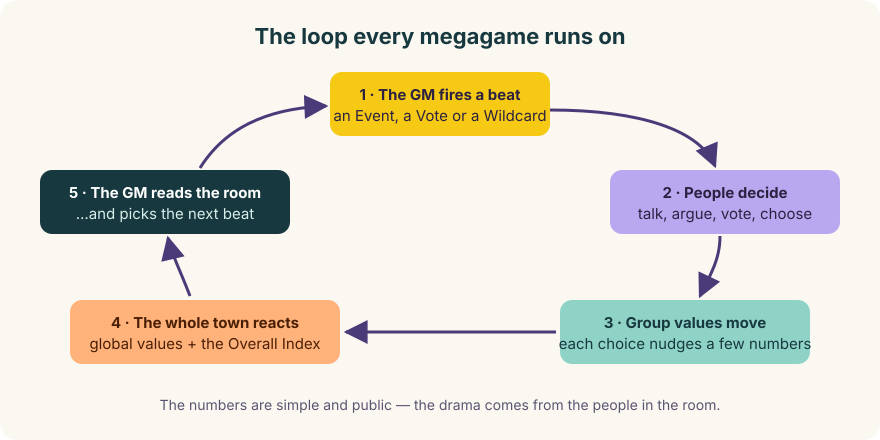
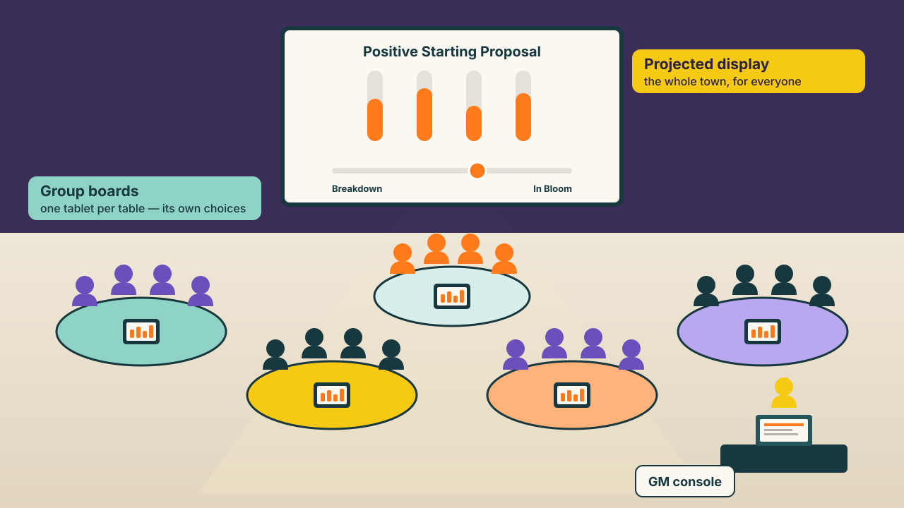
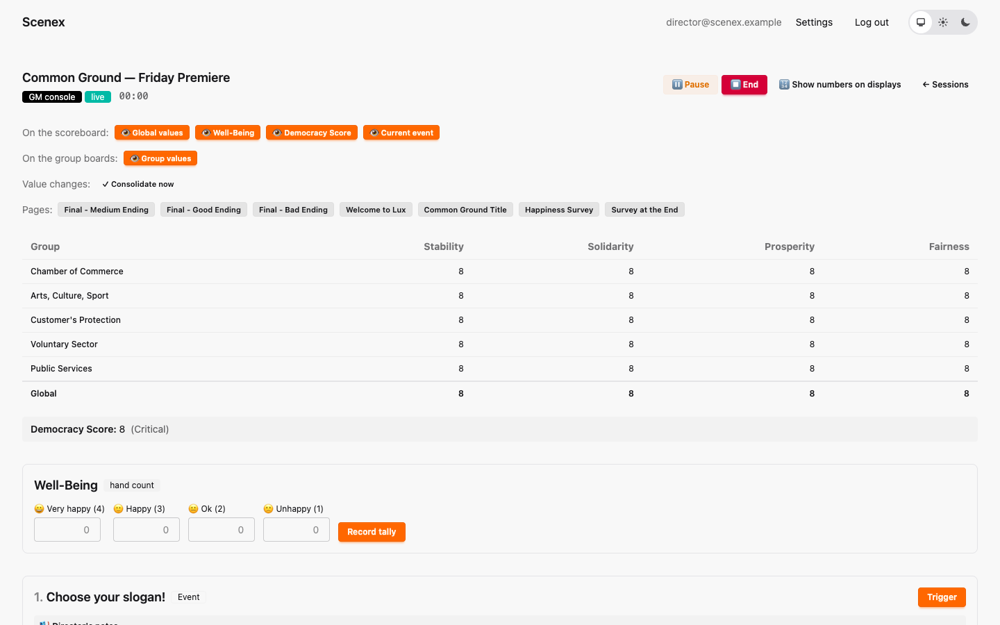
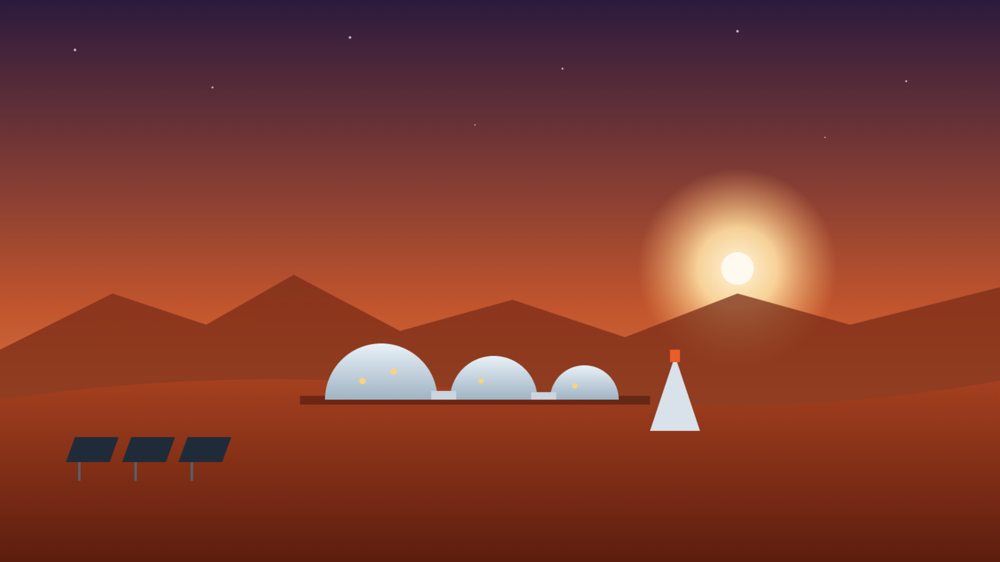

# 1. What is Scenex?

[← Welcome](index.md) · [Next: The building blocks →](02-building-blocks.md)

## A megagame in one paragraph

A megagame is a game for a whole room. There is no audience — **everybody
plays**. People are split into groups, each group stands for a part of
society (or a ship's crew, or a village…), and the evening runs along a
story. Crises hit, the groups argue, negotiate, vote — and every decision
leaves a mark on the world. At the end, the world is in a state that *this
room* created. Nobody wins. The question is what kind of world you made
together.

Scenex is the machinery behind that evening.

## The game loop

Every megagame in Scenex — Common Ground, Mars Colony, the one you'll write —
runs on the same loop:

1. The **game master** fires the next beat of the story.
2. The **groups** talk and decide.
3. Each decision moves a few **numbers** for that group.
4. From those, Scenex calculates how the **whole society** is doing — and
   shows it to everyone.
5. The game master reads the room and the numbers, and picks what happens
   next.

The maths stays small and visible, so everyone can see *why* a number moved.
All the drama comes from people.

## The script and the performance

Scenex separates two things that theatre people know very well:

| | In the theatre | In Scenex |
|---|---|---|
| **The script** | the play, written once | a **scenario** — written in the *editor* |
| **The performance** | one evening, one venue, one audience | a **session** — run from the *GM console* |

You write Common Ground once. Then you can perform it as often as you like —
and even in many theatres on the same night. Every performance is a separate
session, with its own room, its own decisions and its own ending; they never
touch each other. And if someone edits the script during a show, the running
performance doesn't notice: each session keeps the version it started with.

## The three screens

During a show, three kinds of screen are in use:

| Screen | Who looks at it | What it shows |
|---|---|---|
| **GM console** | the game master, on a laptop | everything: all numbers, all choices, the director's notes, every button |
| **Group board** | each group, on a tablet or phone at its table | that group's own values and its own choices — nobody else's |
| **Projected display** | the whole room, on the projector | how the whole society is doing, what's happening right now, pictures and the finale |

Players never create an account or log in. Every table scans a **QR code**
and its board opens. That's it.

## Who's in charge? Humans.

This is the most important rule of the whole platform:

> **The system proposes — the game master disposes.**

Scenex never fires anything on its own. The game master triggers every beat,
judges every Wildcard, breaks ties and chooses the ending. When Scenex
suggests something — "this ending fits the final numbers", "this option is
locked" — it is a suggestion. There are no dice and no hidden randomness;
everything that happens, happens in the open, decided by people.

And mistakes are fine: if someone taps the wrong option, the game master
simply enters the right one, and everything is recalculated.

## One platform, many worlds

Here are two scenarios, side by side. Same platform, same building blocks:

| | Common Ground | Mars Colony |
|---|---|---|
| Setting | the town of Lux, a hat factory, a mineral spring and a tempting offer | the first human colony on Mars |
| Groups | Chamber of Commerce, Arts/Culture/Sport, Customer's Protection, Voluntary Sector, Public Services | Engineering, Science, Agriculture, Medical, Command |
| What it measures | Stability, Solidarity, Prosperity, Fairness | Life Support, Supplies, Progress, Risk |
| Headline score | Democracy Score | Colony Vitality |
| Duration | about 3 hours, 30–60 players | about 1 hour, 25 players |

What you can model is up to you. Let's look at the building blocks.

---

[← Welcome](index.md) · [Next: The building blocks →](02-building-blocks.md)
