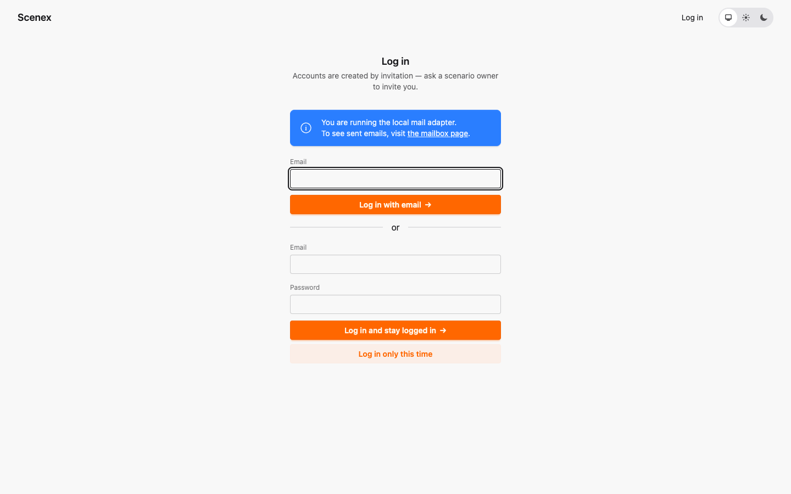
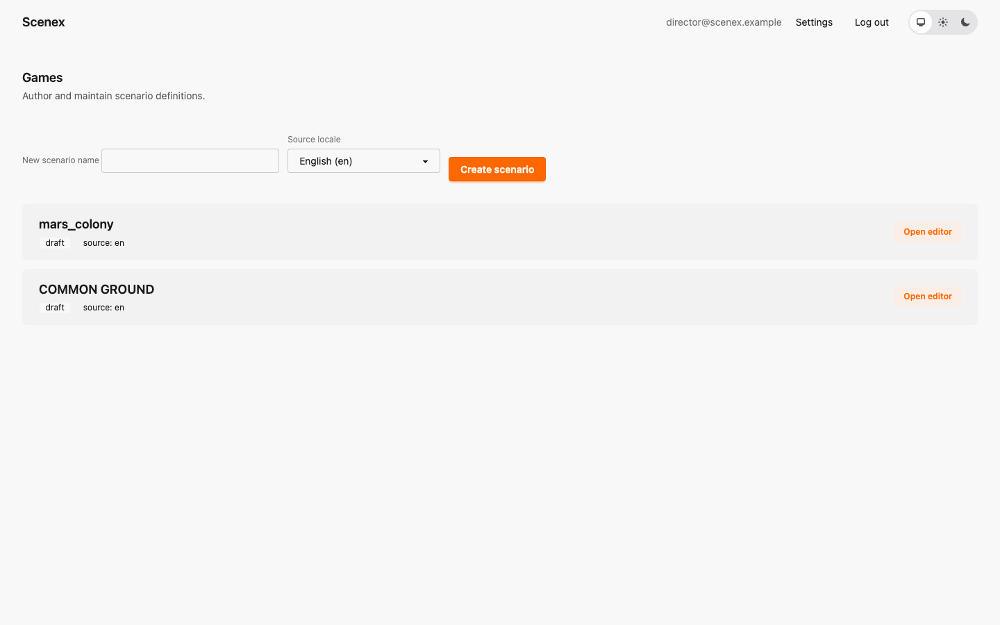
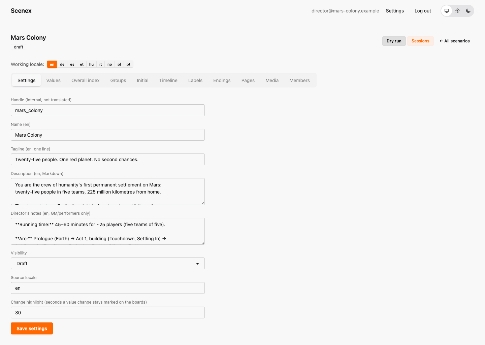

# 2. Getting started

[← How Scenex thinks](01-concepts.md) · [Contents](index.md) · [Next: Values and the Overall Index →](03-values-and-index.md)

## Logging in

Authors and game masters need an account; players never do. Log in at
[scenex.org](https://scenex.org) with your email address. You can either get a
**magic link** by email (no password needed) or use a password if you have
set one.

If someone invited you to work on their scenario, the invitation email
contains a link that creates your account and opens the scenario.

## The scenario list

After logging in you see **Games** — every scenario you are a member of, plus
scenarios that are published for everyone.

To start a new scenario, type a name, choose its **source locale** (the
language you will write it in first) and click **Create scenario**. To work on
an existing one, click **Open editor**.

## The editor

The editor has a row of tabs, one per kind of content. Work through them
roughly from left to right — that is also the order of this tutorial:

| Tab | What you define there | Chapter |
|---|---|---|
| Settings | name, description, visibility, languages | below |
| Values | what the game measures | [3](03-values-and-index.md) |
| Overall index | the single headline score | [3](03-values-and-index.md) |
| Groups | the teams in the room | [4](04-groups.md) |
| Initial | every group's starting numbers | [4](04-groups.md) |
| Timeline | Events, Wildcards and Votes, with their options | [5](05-timeline.md) |
| Labels | coloured tags for options | [6](06-more-content.md) |
| Endings | the possible final scenes | [6](06-more-content.md) |
| Pages | full-screen slides for the projector | [6](06-more-content.md) |
| Media | images, video and sound for your texts | [6](06-more-content.md) |
| Members | who else may edit (owner only) | [6](06-more-content.md) |

At the top right are two more buttons: **Dry run** tests the scenario
([chapter 8](08-dry-run.md)), **Sessions** runs it live ([chapter 9](09-sessions.md)).

The **Working locale** row switches the language you are editing — see
[Translating a scenario](07-translation.md).

## Settings

- **Handle** — the internal name (`mars_colony`). Shown in the scenario list.
- **Name**, **Tagline**, **Description** — how you present the scenario.
- **Director's notes** — notes for the game master only. Almost every piece of
  content has this field; players never see it. Mars Colony keeps its whole
  run sheet here.
- **Visibility** — *Draft* (only members see it), *Invite only*, or
  *Published* (every logged-in user can see and dry-run it, but only members
  can edit).
- **Source locale** — the language the scenario is written in first. Any text
  not yet translated falls back to this language.
- **Change highlight** — how many seconds a changed value stays marked on the
  boards after a decision.

Click **Save settings** when you are done. Each tab has its own save button —
nothing is saved until you click it.

### Markdown

Every long text field (descriptions, narratives, director's notes, pages) is
written in **Markdown**: `**bold**`, `*italic*`, `- ` for a bullet list,
`# ` for a heading. Images and video from the media library can be embedded
too (see [chapter 6](06-more-content.md#media)).

---

[← How Scenex thinks](01-concepts.md) · [Contents](index.md) · [Next: Values and the Overall Index →](03-values-and-index.md)
