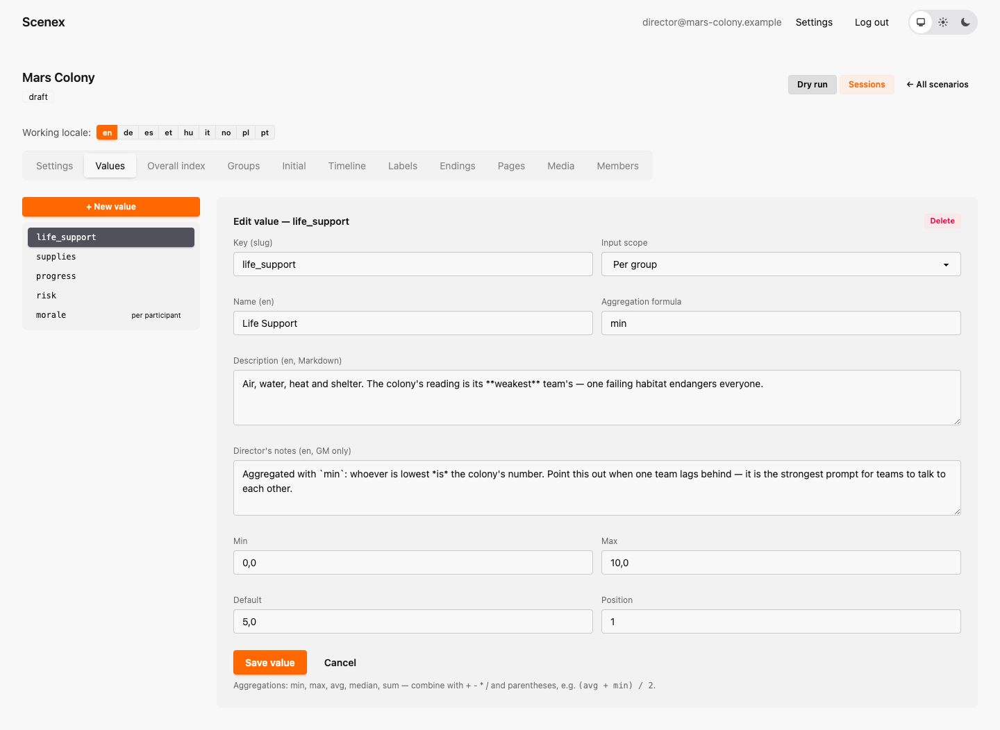
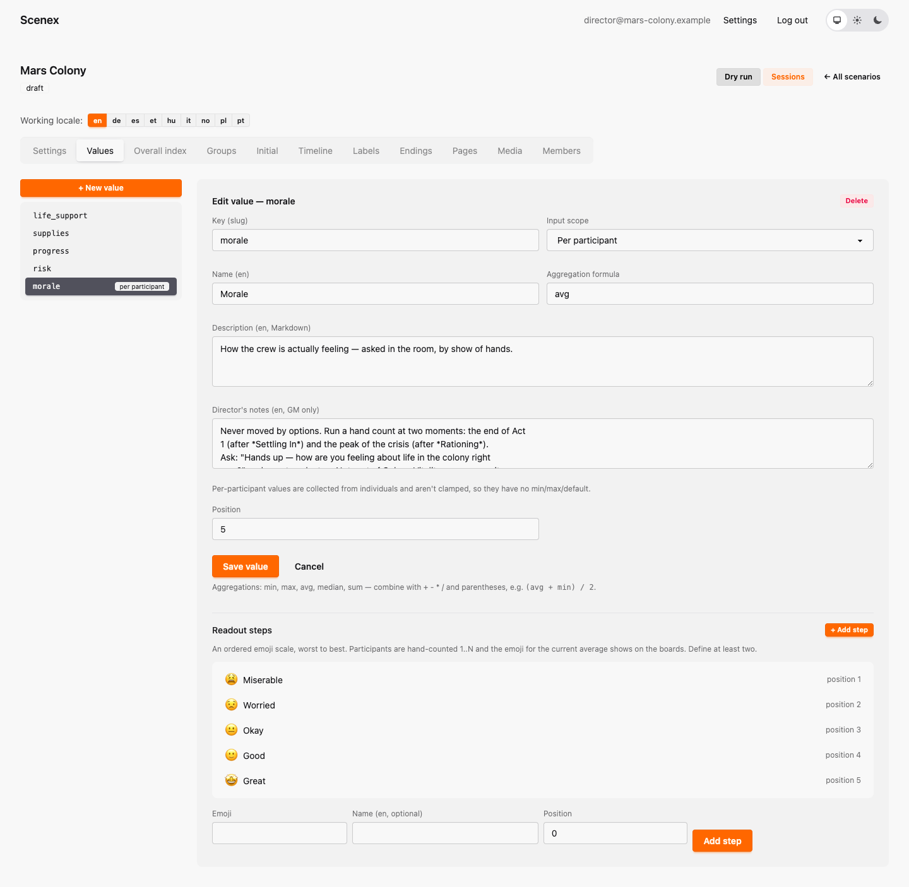

# 3. Values and the Overall Index

[← Getting started](02-getting-started.md) · [Contents](index.md) · [Next: Groups and starting values →](04-groups.md)

Values are what your game measures. Choose few — four or five is plenty — and
make each one mean something the players can feel.

Mars Colony measures:

| Value | Key | Formula | Why this formula |
|---|---|---|---|
| Life Support | `life_support` | `min` | the colony is only as safe as its weakest team |
| Supplies | `supplies` | `(avg + min) / 2` | the average counts, but nobody may be left with nothing |
| Progress | `progress` | `median` | one brilliant team can't make the whole colony look advanced |
| Risk | `risk` | `max` | one reckless team endangers everyone (high is bad!) |
| Morale | `morale` | — | counted by show of hands, per participant |

## Creating a value

Open the **Values** tab and click **+ New value**, or click an existing value
in the list on the left.

- **Key** — a short lowercase name without spaces (`life_support`). Formulas
  and conditions use it, so choose it carefully and don't change it later.
- **Name** — what players see ("Life Support").
- **Input scope** — *Per group* (each group holds a number) or *Per
  participant* (counted by show of hands, see below).
- **Aggregation formula** — how the groups' numbers become the global number.
- **Description** — shown to players; explain what the value means.
- **Min / Max** — the range. Effects can never push a value outside it.
  Mars Colony uses 0–10 for everything, which keeps it easy to read.
- **Default** — pre-fills the starting values grid (see the next chapter).
- **Position** — the order in which values appear.

### Aggregation formulas

The formula is where your game's politics live. The building blocks:

| Formula | Meaning | Feels like |
|---|---|---|
| `avg` | the average of all groups | "we are all in this together" |
| `min` | the lowest group | "a chain is as strong as its weakest link" |
| `max` | the highest group | "one troublemaker is enough" |
| `median` | the middle group | "the typical group" — outliers don't count |
| `sum` | all groups added up | "the total pot" |

You can combine them with `+ - * /` and parentheses: `(avg + min) / 2`
rewards the room for lifting its poorest group without ignoring the
average.

> **Try it.** In Mars Colony, Command starts with Life Support 3 while
> everyone else has 5 or 7. Because Life Support uses `min`, the whole colony
> reads 3 — until Command fixes its own problem or the room notices. That one
> formula creates a conversation between tables.

## Per-participant values (Morale)

A per-participant value is not held by groups. Instead the game master asks
the room a question and counts hands on a small scale. You define that scale
as **steps** — each with an emoji and a label, from worst to best.

Mars Colony's Morale scale: 😫 Miserable · 😟 Worried · 😐 Okay · 🙂 Good ·
🤩 Great. Options can never change a per-participant value — only the count
in the room does. That makes it an honest reality check next to the numbers
the game produces.

## The Overall Index

The **Overall index** tab combines the global values into one headline score
that the projected display shows as a moving dot between two labels.

- **Name** — call it something that fits your world: *Colony Vitality*,
  *Democracy*, *Ship Integrity*.
- **Formula** — uses value **keys**. Mars Colony's:
  `(life_support + supplies + progress + (10 - risk)) / 4`.
  Risk is "high is bad", so it enters as `10 - risk`.
  Morale is left out on purpose: it only changes at tally moments and would
  make the score jump.
- **Min / Max** — the range of the score.
- **Visualization min / max** (optional) — a narrower window for the gauge on
  the display. Mars Colony's score really lives between about 2 and 8, so the
  gauge shows 1–9 and every change becomes visible.
- **Score bands** — labels from worst to best (*Barely Holding On,
  Struggling, Getting By, Steady, Thriving*). They split the range evenly. The
  display only ever shows the worst and the best label, at the two ends of the
  gauge; the console and the dry run show which band the score is in.

---

[← Getting started](02-getting-started.md) · [Contents](index.md) · [Next: Groups and starting values →](04-groups.md)
