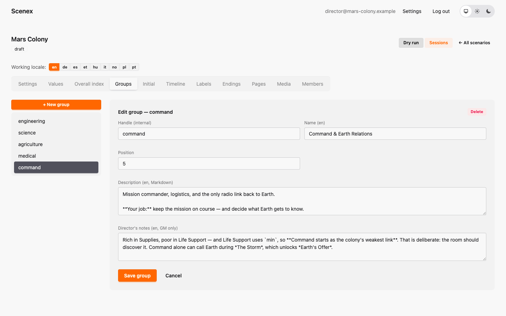
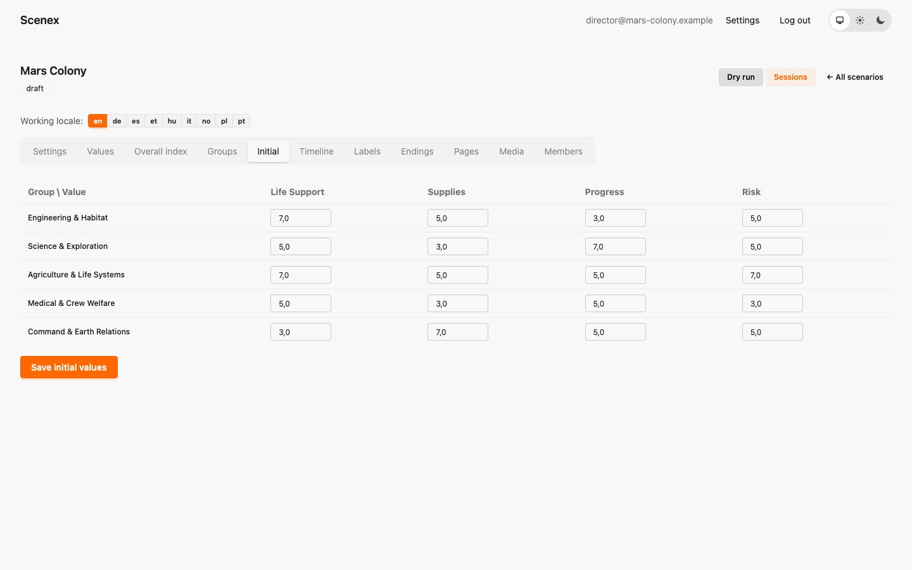

# 4. Groups and starting values

[← Values and the Overall Index](03-values-and-index.md) · [Contents](index.md) · [Next: The timeline →](05-timeline.md)

## Groups

A **group** is one team in the room — one table, one group board. Mars Colony
has five: Engineering & Habitat, Science & Exploration, Agriculture & Life
Systems, Medical & Crew Welfare, and Command & Earth Relations.

- **Handle** — internal name (`command`).
- **Name** — what everyone sees.
- **Description** — the group's role sheet: who they are, what they want,
  what they will argue about. Players read it on their own board.
- **Director's notes** — what the game master should know about this group.
- **Position** — the order on boards and in the console.

Deleting a group **archives** it: it disappears from the editor and from new
sessions, but sessions that already played with it still replay correctly.

## Starting values

The **Initial** tab is a grid: every group × every per-group value.

Give groups **different starting positions instead of different rules**.
Every group in Mars Colony starts at 5 everywhere, then gets +2 on one
strength and −2 on one weakness:

| Group | Strength | Weakness |
|---|---|---|
| Engineering | Life Support 7 | Progress 3 |
| Science | Progress 7 | Supplies 3 |
| Agriculture | Life Support 7 | Risk 7 (high is bad) |
| Medical | Risk 3 (low is good) | Supplies 3 |
| Command | Supplies 7 | Life Support 3 |

The result is that Colony Vitality starts in *Struggling* — on purpose. The
Prologue gives every team a chance to fix its weakness, so the first choices
visibly matter.

> **Click "Save initial values"** after changing the grid. A group without a
> saved starting value begins at the value's minimum.

---

[← Values and the Overall Index](03-values-and-index.md) · [Contents](index.md) · [Next: The timeline →](05-timeline.md)
