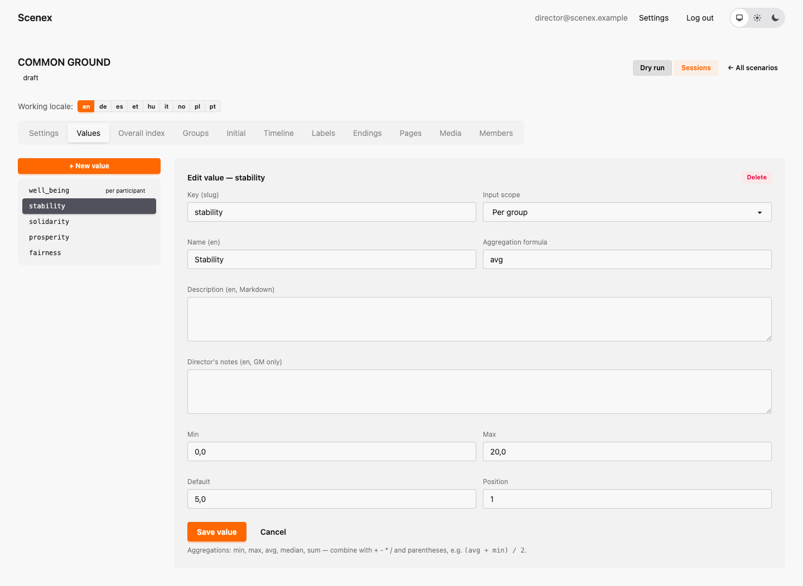
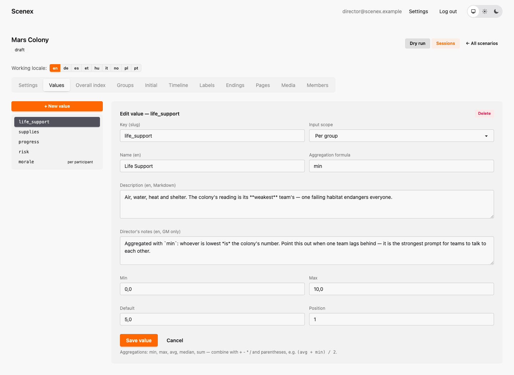
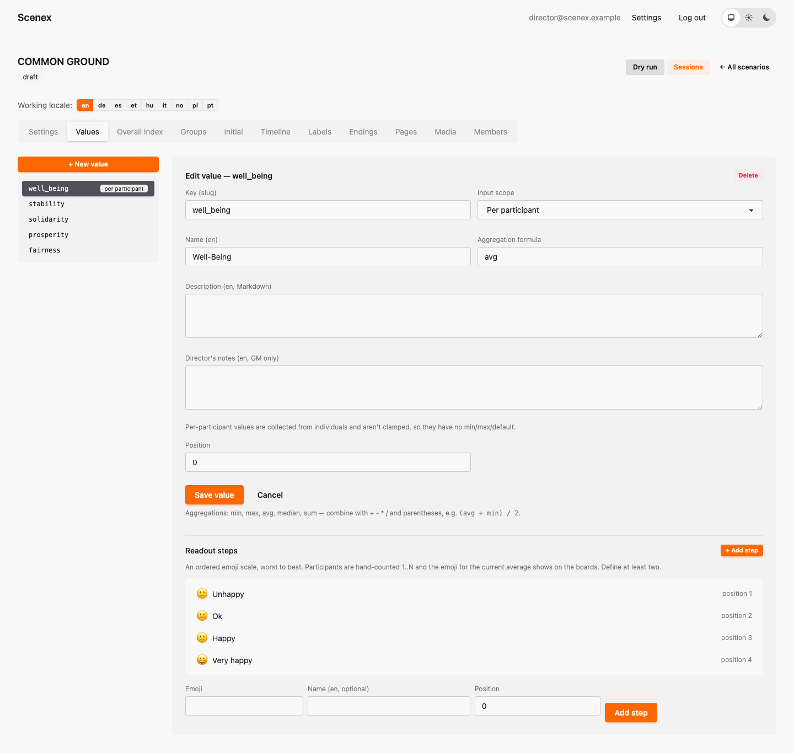
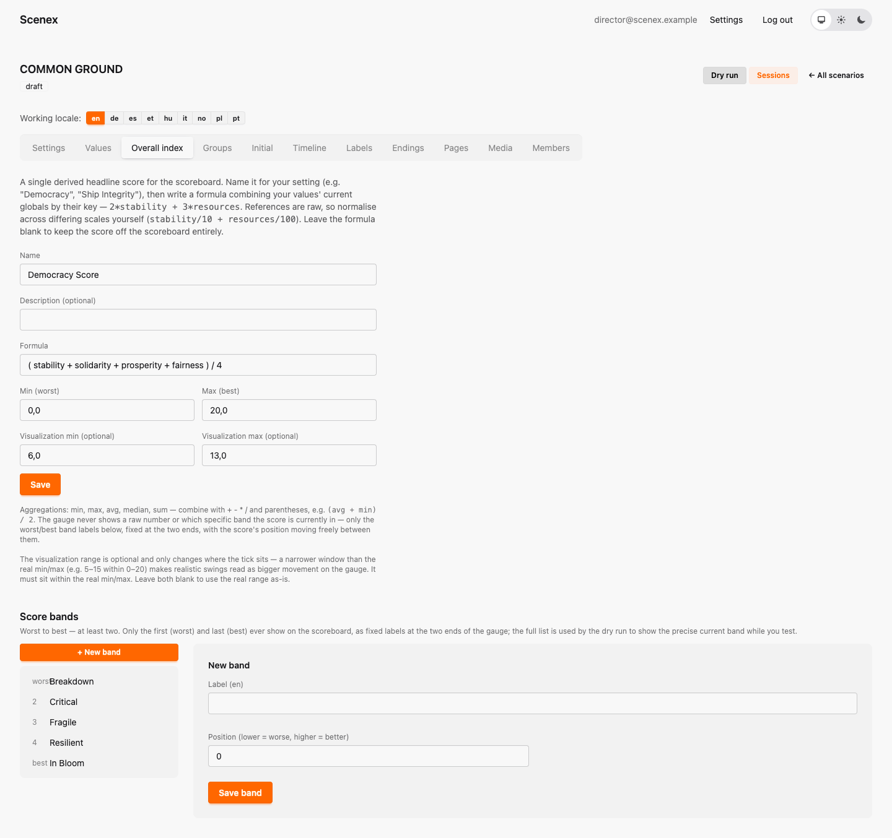

# 4. Values and the Democracy Score

[← A tour of the editor](03-editor-tour.md) · [Contents](index.md) · [Next: Groups and starting values →](05-groups.md)

*Background: values, global values, the Overall Index and well-being in
[The building blocks](02-building-blocks.md).*

## The Values tab

On the left you see the list of values; click one to edit it. Here is
Common Ground's **Stability**:

- **Key** — a short internal name without spaces (`stability`). Formulas use
  it, so pick it once and leave it alone.
- **Name** — what everyone sees: "Stability".
- **Input scope** — *Per group* (each group has a number) or *Per
  participant* (counted by show of hands — see well-being below).
- **Aggregation formula** — how the groups' numbers become the global
  number: `avg`, `min`, `max`, `median` or `sum`.
- **Description** — tell the players what this value means.
- **Director's notes** — for the game master.
- **Min / Max** — the range. Common Ground uses 0 to 20.
- **Default** — a suggestion for the starting values grid.

### Mixing formulas

Formulas can be combined with `+ - * /` and brackets. For example
`(avg + min) / 2` counts the average *and* the weakest group — the room can
only do well if nobody is left behind.

🪐 *Here is a value that uses `min` — Mars Colony's Life Support. Whichever
team is lowest **is** the colony's Life Support:*

## Well-being: a value counted by hand

Set the input scope to **Per participant**, and the value is no longer
calculated. Instead you define **steps** — an emoji and a word for each
answer, from worst to best:

During the show, the game master asks the room, counts hands per step, and
types in the numbers ([chapter 11](11-running-the-show.md#asking-the-room)).
No decision can ever change this value.

## The Democracy Score

The **Overall index** tab rolls everything up into one headline score:

- **Name** — what you call it. Common Ground: *Democracy Score*.
- **Formula** — uses the value **keys**. Common Ground's:
  `( stability + solidarity + prosperity + fairness ) / 4` — the average of
  the four global values.
- **Min / Max** — its range, 0 to 20.
- **Visualization min / max** *(optional)* — a narrower window for the
  projector. If the score only ever moves between, say, 6 and 14, set that
  window and every change becomes visible on the gauge.
- **Score bands** — labels from worst to best: *Breakdown, Critical, Fragile,
  Resilient, In Bloom*. The projector only shows the first and the last, at
  the two ends of the gauge. The console and the dry run tell you which band
  the score is in right now.

> 💡 Well-being is not part of the formula — on purpose. It only changes when
> the room is asked, and it's meant to be compared *with* the score, not
> mixed into it.

---

[← A tour of the editor](03-editor-tour.md) · [Contents](index.md) · [Next: Groups and starting values →](05-groups.md)
