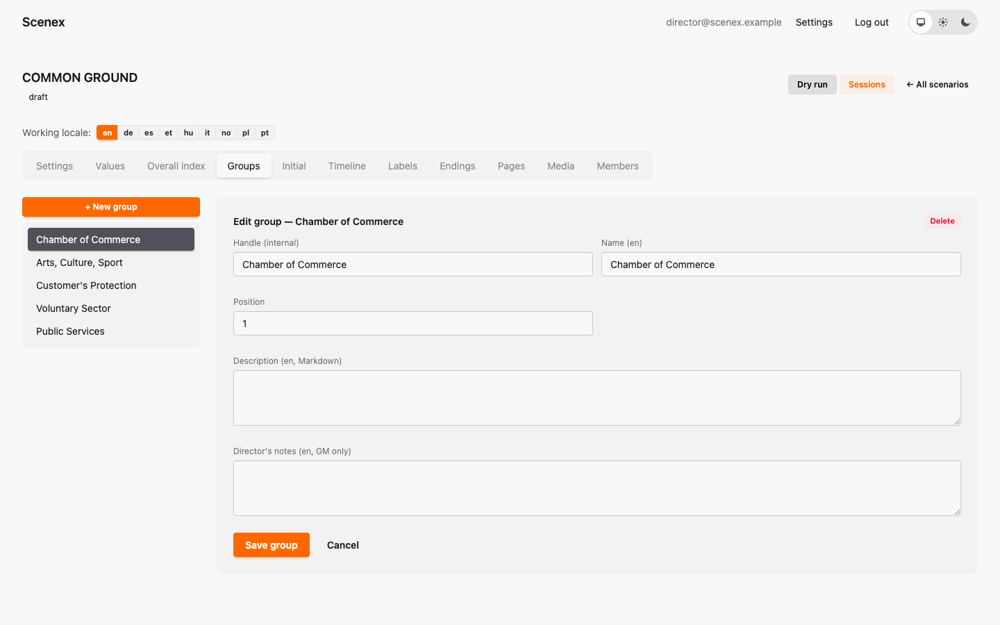

# 5. Groups and starting values

[← Values and the Democracy Score](04-values.md) · [Contents](index.md) · [Next: The timeline →](06-timeline.md)

## Groups

The **Groups** tab lists the teams. Click one to edit it:

- **Handle** — the internal name.
- **Name** — what everyone sees.
- **Description** — the group's role card: who they are, what they want,
  what they'll argue about. Players can read it on their board.
- **Director's notes** — what the game master should know about this group.
- **Position** — the order on the screens.

Deleting a group **archives** it: it disappears from new performances, but
sessions that were played with it keep working.

> ✍️ Common Ground's groups don't have descriptions yet. It's a great place
> for each group's role card — players read it right on their table.

## Starting values

The **Initial** tab is a grid: every group × every value.

In Common Ground, **every group starts equal**: 8 in everything. The
differences grow out of the decisions.

🪐 *Mars Colony does the opposite: every team starts with one strength and one
weakness (e.g. Command: lots of Supplies, but the weakest Life Support). The
groups have different starting positions, but the same rules — and the
room has to discover who needs help.*

Both are good designs; they tell different stories.

> Click **Save initial values** after changing the grid. A group without a
> saved value starts at the value's minimum.

---

[← Values and the Democracy Score](04-values.md) · [Contents](index.md) · [Next: The timeline →](06-timeline.md)
