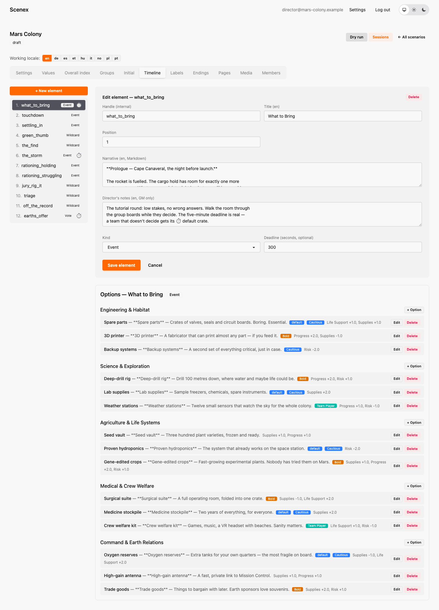
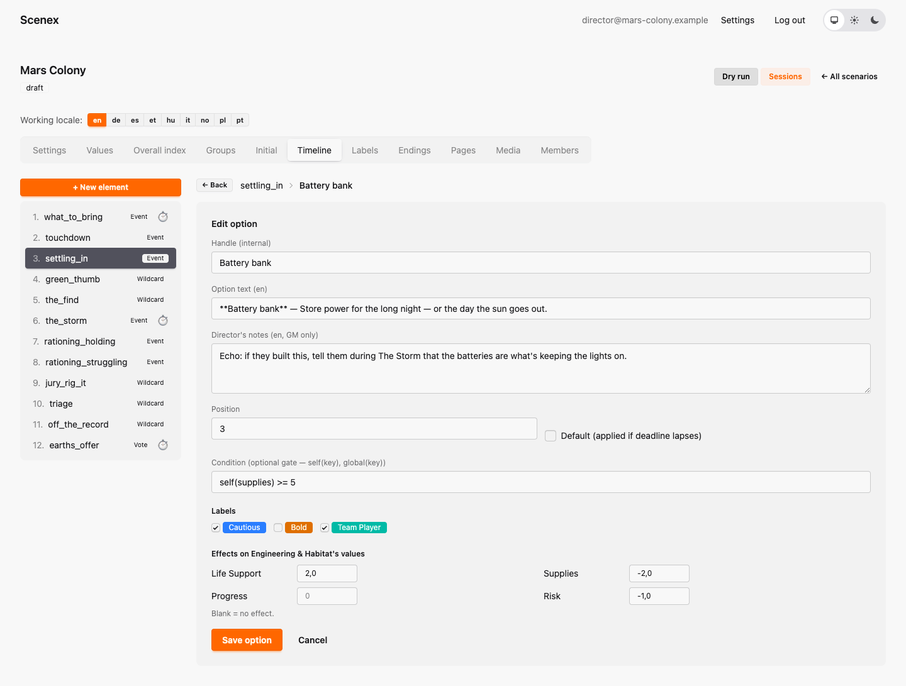
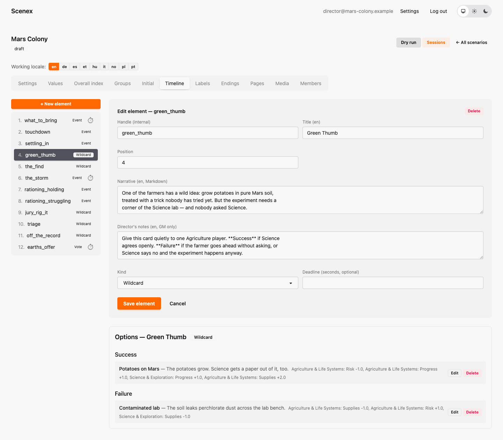
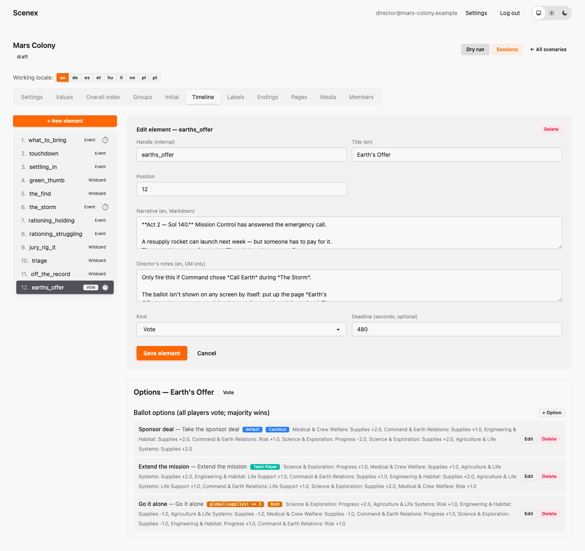
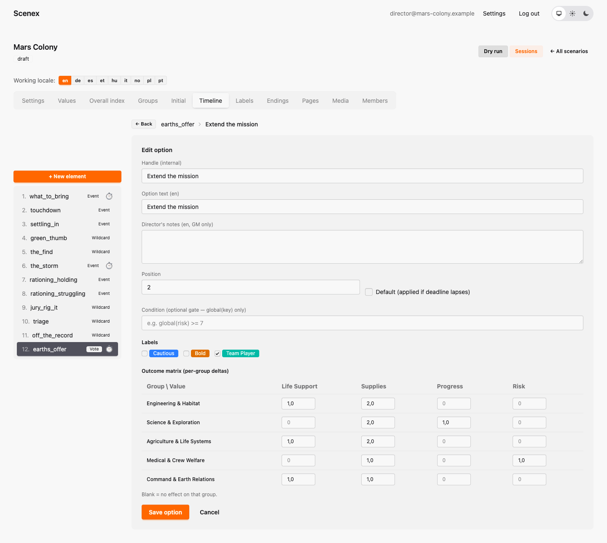

# 5. The timeline: Events, Wildcards and Votes

[← Groups and starting values](04-groups.md) · [Contents](index.md) · [Next: Labels, endings, pages, media and members →](06-more-content.md)

The **Timeline** tab holds the story: a numbered list of beats on the left,
the selected beat on the right, and its options underneath. The numbers are
only an order for the game master's console — during a show the GM fires the
beats in any order, skips some, or fires one twice in different sessions.

Mars Colony's timeline:

| # | Beat | Kind | Purpose |
|---|---|---|---|
| 1 | What to Bring | Event, 5-minute deadline | Prologue on Earth; teaches the boards |
| 2 | Touchdown | Event | Act 1: first improvised calls |
| 3 | Settling In | Event, gated options | Act 1: the big investments that Act 2 pays off |
| 4 | Green Thumb | Wildcard | Agriculture needs Science's lab |
| 5 | The Find | Wildcard | Science's mysterious discovery |
| 6 | The Storm | Event, 4-minute deadline | Act 2: the crisis |
| 7 | Rationing (holding together) | Event | Act 2: milder version… |
| 8 | Rationing (struggling) | Event | …or harsher version — the GM fires one |
| 9 | Jury-Rig It | Wildcard | Engineering borrows a pump |
| 10 | Triage | Wildcard | Medical must make a hard call |
| 11 | Off the Record | Wildcard | someone learns about Earth's reply |
| 12 | Earth's Offer | Vote, 8-minute deadline | the whole colony decides |

## Creating a beat

Click **+ New element**. Every beat has:

- **Handle** — internal name (`what_to_bring`).
- **Title** — what the room sees.
- **Narrative** — the story text, in Markdown. Shown on the group boards for
  Events. Write it to be read aloud, too.
- **Director's notes** — staging, timing and improvisation tips for the
  game master. They appear in the console right under the beat.
- **Kind** — Event, Wildcard or Vote.
- **Deadline** (optional) — a countdown in seconds, started when the GM fires
  the beat. It runs on the *game clock*, so pausing the session pauses it.
- **Position** — the order in the list.

## Events

An Event lets **every group decide separately**, each from its own options.
Engineering never sees Science's choices — each table gets its own dilemma.

Below the beat you see one block per group, each with **+ Option**. An option
has:

- **Handle** — internal name, unique within this beat.
- **Option text** — one line the players see on their board. Mars Colony uses
  `**Title** — one sentence`, e.g. `**Spare parts** — Crates of valves, seals
  and circuit boards. Boring. Essential.`
- **Director's notes** — e.g. which later beat this choice echoes into.
- **Default** — the option applied automatically if the deadline runs out
  before this group has decided. At most one per group. A group without a
  default simply stays undecided.
- **Condition** — an optional **gate**, see below.
- **Labels** — coloured tags such as *Cautious* or *Bold*
  ([chapter 6](06-more-content.md#labels)).
- **Effects** — how much this choice changes the deciding group's own values.
  `+2` raises, `-1` lowers, blank means no change.

### Gates

A gate makes an option available only under a condition. *Battery bank*
needs `self(supplies) >= 5`: Engineering may only build it if its own
Supplies are 5 or more at the moment the beat is fired.

On the group board a locked option stays **visible but greyed out**, with its
condition shown — players see what they would have needed. The game master's
console ignores gates, so the GM can always override.

Condition syntax:

- `self(key)` — the deciding group's own value (Events only)
- `global(key)` — the room's global value
- numbers, `+ - * /` and parentheses
- exactly one comparison: `>=  <=  >  <  ==  !=`

Examples: `self(supplies) >= 5`, `global(risk) < 8`,
`(self(progress) + self(supplies)) / 2 > 5`. There is no `and`/`or` — if you
need two conditions, write two options or a director's note.

### Writing good options

- Two or three options per group is enough. Make each a real dilemma, not a
  "right answer" and two wrong ones.
- **Every option should cost something.** In Mars Colony the cautious option
  usually protects Life Support or lowers Risk but gains nothing; the bold one
  gains Progress or Supplies and adds Risk.
- Keep effects small: ±1 is a nudge, ±2 is a real choice, ±3 is a big moment.
  On a 0–10 scale, larger numbers quickly hit the floor or ceiling.
- Think about the **formula** of each value. A +2 to Engineering's Life
  Support changes nothing for the colony if Engineering isn't the lowest team
  — the `min` ignores it. That is a feature: it tells the room where help is
  needed.
- **Echoes** between beats (the solar field built in Act 1 is buried by the
  storm in Act 2) are best done as director's notes. The GM names them aloud;
  the numbers don't need to know.

## Wildcards

A Wildcard is a secret mission for **one player**, judged by the game master.
It has exactly two outcomes, **Success** and **Failure**; nobody chooses
between them — the GM decides what happened, whenever it fits.

Each outcome has an **outcome matrix**: effects on *any* group's values, not
just one. In *Green Thumb*, success raises Agriculture's Supplies and
Science's Progress; failure costs both teams.

The narrative of a Wildcard is the mission card. It is not shown on any
screen by itself — print it, or read it to the player quietly. The director's
notes say who gets it and what counts as success.

## Votes

A Vote is one ballot for **the whole room**, one person one vote. People vote
by show of hands; the game master types the count into the console and
declares the result (and breaks ties).

Ballot options belong to nobody in particular, so each has an **outcome
matrix** across all groups:

- Gates on ballot options may only use `global(key)`. *Go it alone* requires
  `global(supplies) >= 3` — a colony that is already starving cannot afford
  to refuse help.
- With a deadline, one option can be the **default** winner if the GM doesn't
  declare a result in time.
- Keep the option text short. The winner is shown large on the projected
  display; the explanation goes on a [Page](06-more-content.md#pages) that the
  GM shows while the room campaigns.

## Two versions of one beat ("shades")

Sometimes the same story moment should feel different depending on how the
game is going. Mars Colony's *Rationing* exists twice — *Holding Together*
(mild) and *Struggling* (harsh) — with the same title, so players never know
there was another version. The director's notes tell the GM which one to fire:
the milder one if Colony Vitality is *Getting By* or better.

Use this sparingly; every shade is a beat you write twice.

---

[← Groups and starting values](04-groups.md) · [Contents](index.md) · [Next: Labels, endings, pages, media and members →](06-more-content.md)
