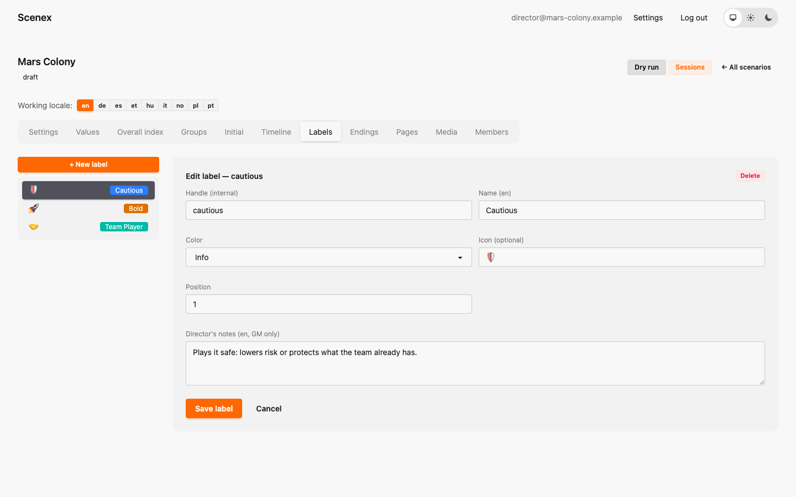
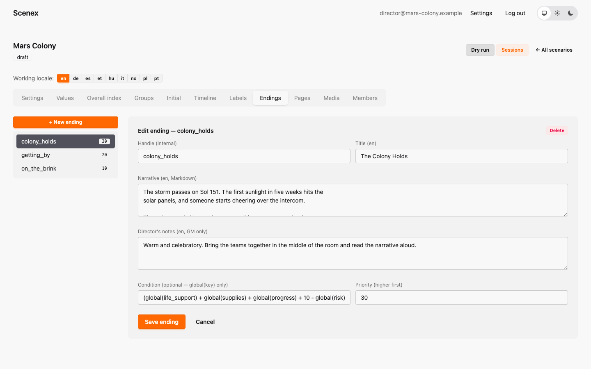
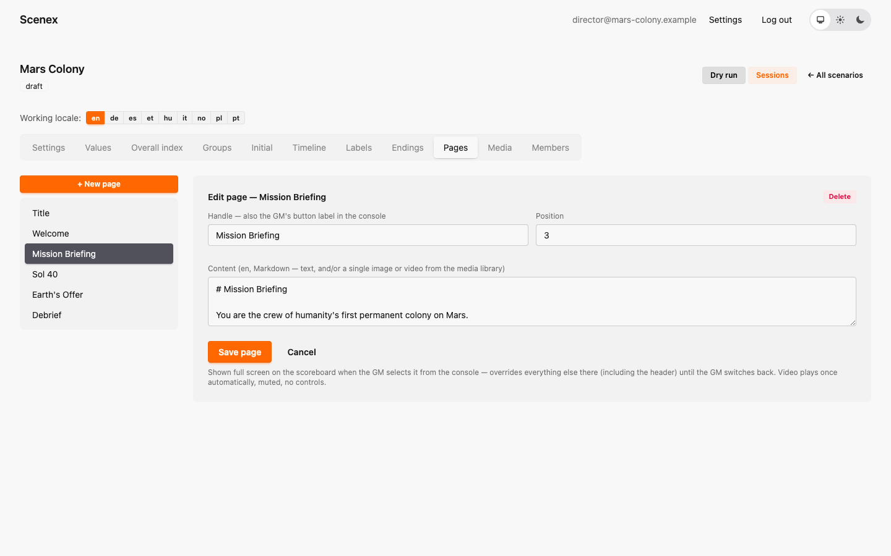
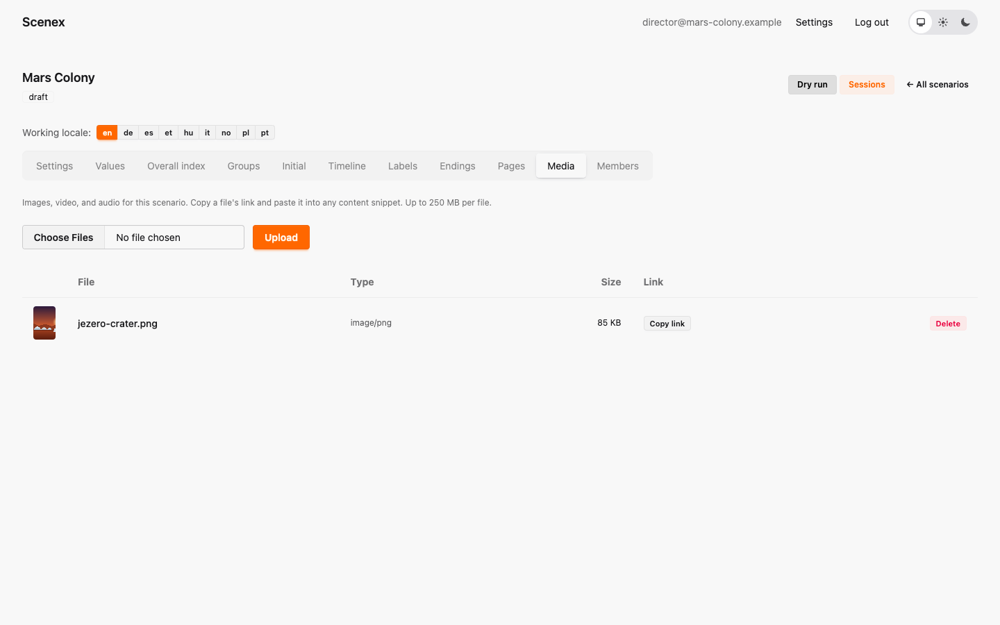
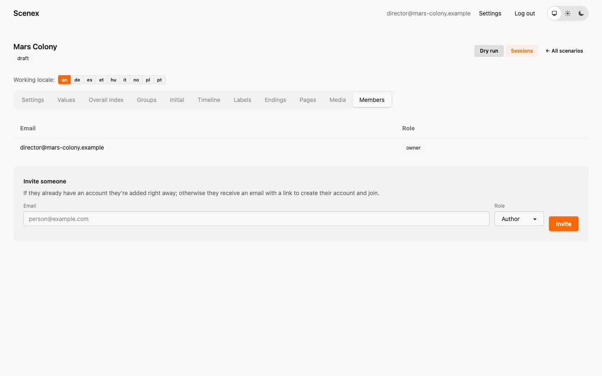

# 6. Labels, endings, pages, media and members

[← The timeline](05-timeline.md) · [Contents](index.md) · [Next: Translating a scenario →](07-translation.md)

## Labels

Labels are small coloured tags for options — Mars Colony uses three:
🛡️ **Cautious**, 🚀 **Bold** and 🤝 **Team Player**. They help a table read
its options at a glance, and they help you check your own balance ("does
every group have a cautious option?").



A label has a handle, a name, a colour, an optional icon (an emoji) and
director's notes. Labels never change any numbers. Attach them to options in
the option editor.

## Endings

An ending is the final scene the game master reads out and the projected
display shows. Endings change no numbers — the game is over when one is
chosen.



- **Title** and **Narrative** — what the room sees and hears.
- **Director's notes** — how to stage it.
- **Condition** — optional. When the session ends, every ending whose
  condition is true is marked **recommended** in the console. The GM can still
  pick any ending.
- **Priority** — higher priority endings are listed first.

Conditions on endings may only use `global(key)`. Mars Colony's three endings
all look at Colony Vitality. Because conditions can't reference the Overall
Index directly, they repeat its formula:

| Ending | Condition (Vitality is …) | Priority |
|---|---|---|
| The Colony Holds | ≥ 5.5 | 30 |
| Getting By | ≥ 3.5 | 20 |
| On the Brink | < 3.5 | 10 |

A strong colony matches both *The Colony Holds* and *Getting By*; the higher
priority puts the better ending first. Keep endings for teenagers sobering
rather than bleak — Mars Colony's worst ending is "barely holding on", never
collapse.

## Pages

A page is a full-screen slide for the projected display: a welcome screen
while people arrive, an act break, the rules of a vote, a debrief. When the
game master shows a page it takes over the whole display; the game keeps
running underneath.



A page has a **handle** (also the button text in the console) and its
**content** in Markdown — text, and/or one image or video from the media
library. A video on a page plays automatically, once.

Mars Colony's pages: *Title* (just the illustration), *Welcome*, *Mission Briefing*, *Sol 40* (the act break
before the storm), *Earth's Offer* (the three ballot options, shown while the
room campaigns) and *Debrief*.

## Media

The **Media** tab is the scenario's library of images, video and sound
(up to 250 MB per file).



Upload a file, copy its link, and paste it into any Markdown text:

```markdown

```

An image shows as an image; a link to a video or audio file becomes a player.
Mars Colony uses one illustration, on its *Title* page and in the
*Touchdown* narrative.

## Members

Only the owner of a scenario sees the **Members** tab. Invite people by email
and give them a role:



| Role | Can |
|---|---|
| **Owner** | everything, including members and deleting |
| **Author** | edit all content, run sessions |
| **Viewer** | look and dry-run, but not change anything |

People who already have an account are added immediately; everyone else gets
an email with a link to create their account.

---

[← The timeline](05-timeline.md) · [Contents](index.md) · [Next: Translating a scenario →](07-translation.md)
