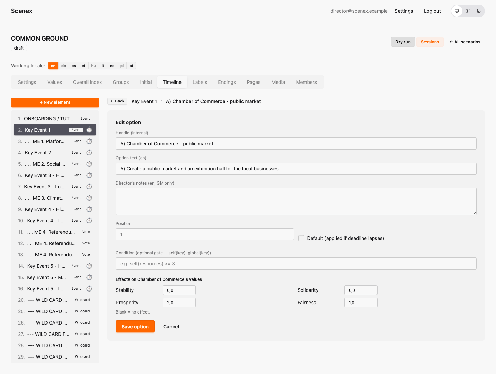
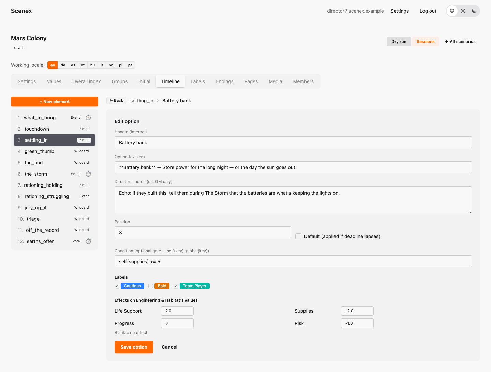

# 6. The timeline

[← Groups and starting values](05-groups.md) · [Contents](index.md) · [Next: Pages, media, endings and more →](07-pages-and-more.md)

*Background: Events, Votes, Wildcards, options and outcome matrices in
[The building blocks](02-building-blocks.md).*

The **Timeline** tab is the heart of the editor: the running order of your
show on the left, the selected beat on the right, and its options below.

Common Ground's timeline, roughly:

| Beats | Kind | What happens |
|---|---|---|
| Choose your slogan! | Event | the warm-up: every group picks its slogan |
| Key Events 1 – 5 | Events | the main story — the Hat Factory, the mineral spring, the IT company's offer, an incomplete truth, the water pact |
| Campaign Selection, Social Media Policy, Climate Change Policy | Events | the candidates' campaigns |
| Referendum 1 – 3 | Votes | the whole town decides |
| Freeze Card ×5, City of Lux receives an investment! | Wildcards | tools for the game master |

The numbers in the list are just an order for the console. During the show
the game master fires beats in any order, skips some, and holds others back.

## Creating a beat

Click **+ New element** (or click a beat to edit it). Every beat has:

- **Key** — the internal name, like `Key Event 1`.
- **Title** — what the room sees: *Positive Starting Proposal*.
- **Description** — the story text. Groups read it on their boards; the game
  master often reads it aloud.
- **Director's notes** — staging and timing for the game master. They show
  up in the console, right under the beat.
- **Kind** — Event, Vote or Wildcard.
- **Deadline** *(optional)* — a countdown in seconds. It runs on the game
  clock, so pausing the show pauses it too.

## Events: one dilemma, many tables

Below an Event you see one block per group, each with its own **+ Option**
button. Every group gets its own choices.

Click **Edit** on an option to open it:

- **Key** — internal name, unique within this beat.
- **Name** — the one line the players read on their board.
- **Director's notes** — e.g. "this choice comes back in Key Event 4".
- **Default** — chosen automatically for this group if the deadline runs
  out. (Common Ground has no defaults: a group that runs out of time simply
  hasn't decided.)
- **Condition** — an optional lock, see below.
- **Labels** — coloured tags ([chapter 7](07-pages-and-more.md#labels)).
- **Effects** — how this choice moves the group's own values. `+2` raises,
  `-1` lowers, blank means no change.

### Writing good options

- **Every option should cost something.** If one option is better in every
  way, nobody needs to talk.
- **Keep effects small.** On Common Ground's 0–20 scale, +1 is a nudge, +2 a
  real step, +4 a big moment.
- **Make each table's dilemma its own.** The same news should feel different
  from the Chamber of Commerce than from the Voluntary Sector.
- **Callbacks belong in director's notes.** If a choice in Key Event 1
  should matter later, tell the game master to mention it — the numbers
  don't need to know.

### Locked options (conditions)

Common Ground doesn't use conditions, so here is Mars Colony: Engineering may
only build a *Battery bank* if its own Supplies are at least 5.

A condition is one comparison:

- `self(supplies)` — the deciding group's own value (Events only)
- `global(risk)` — the value of the whole society
- numbers, `+ - * /`, brackets, and one of `>= <= > < == !=`

Examples: `self(prosperity) >= 5` · `global(stability) < 8`. On the group
board a locked option stays **visible but greyed out**, with its condition.
The game master's console ignores locks — the director can always overrule.

## Votes: the whole room decides

A Vote has one ballot for everybody. Here is Common Ground's *Referendum 2 —
Social Media Policy*:

Open a ballot option, and instead of "effects on my group" you get an
**outcome matrix** — effects for *every* group:

In Common Ground every group gets the same effects from a referendum result.
A matrix can also treat groups differently — *"regulating social media
helps Customer's Protection and hurts the Chamber of Commerce"* — and that
is when campaigning really starts.

Keep ballot options short: the winner appears **large** on the projector.
If the options need explaining, put them on a [page](07-pages-and-more.md#pages)
that the game master shows while the room campaigns.

## Wildcards: a card for one player

A Wildcard has exactly two outcomes, **Success** and **Failure**, each with
its own outcome matrix. Here is Common Ground's Freeze Card for the Chamber
of Commerce:

The description is the text on the card — print it, or read it to the player.
The director's notes say when to use it. Nothing about a Wildcard appears on
the group boards: it's between the player and the game master.

## Two versions of one beat

When the story should react to how the evening is going, write the beat
twice. Common Ground's *Irresistible Proposal* (Key Event 3) exists as
*Higher Democracy Score* and *Lower Democracy Score*: the IT company makes a
friendly partnership offer to a strong town, and tries to simply buy a weak
one. Same title, different story, different options. The key tells the
game master which is which; the players only ever see one.

---

[← Groups and starting values](05-groups.md) · [Contents](index.md) · [Next: Pages, media, endings and more →](07-pages-and-more.md)
