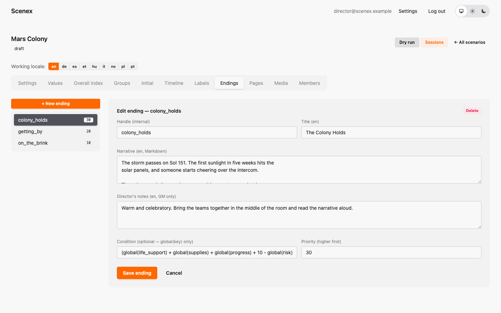
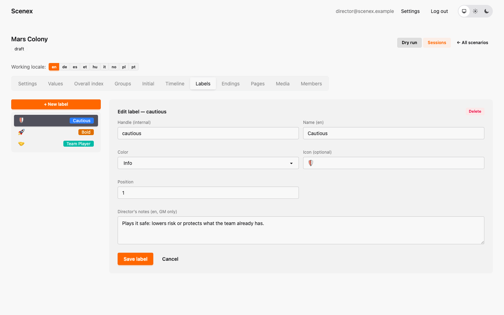

# 7. Pages, media, endings and more

[← The timeline](06-timeline.md) · [Contents](index.md) · [Next: Your Common Ground →](08-your-common-ground.md)

## Pages

Pages are full-screen slides for the projector. The game master can put one
up at any moment — before the show, between beats, at the very end — and the
game keeps running underneath.


A page has:

- a **key** — which is also the button label in the game master's console,
  so make it obvious (*Happiness Survey*, *Final – Good Ending*);
- its **content** — text in Markdown, and/or one picture or video from the
  media library. A video on a page plays automatically, once.

Common Ground's pages are all pictures: *Common Ground Title*, *Welcome to
Lux*, *Happiness Survey*, *Survey at the End*, and the three finales.

## Media

The **Media** tab is the scenario's own picture and sound library (up to
250 MB per file).


Upload a file, copy its link, and paste it into any text — a page, a
description, an option:

```markdown

```

A picture appears as a picture. A link to a video or a sound file becomes a
player.

> 💡 Paste the link exactly as the media library gives it — starting with
> `/media/…`, without `https://scenex.org` in front. Then it works everywhere,
> also in copies of the scenario.

## Endings

An ending is the final scene: a title, a text read out at the end, and
director's notes. When the game master ends the show, Scenex **recommends**
the endings whose condition matches the final numbers — and the game master
chooses.

Common Ground shows its finales as pages. For a scenario with real endings,
here is Mars Colony:



- **Condition** — uses only `global(…)` values, e.g.
  `global(stability) >= 12`.
- **Priority** — when several endings match, the higher priority is listed
  first.

Aim for three to five endings that feel really different — and make sure at
least one of them can be reached from a "middling" evening, so every
performance ends somewhere earned.

## Labels

Labels are coloured tags for options (🪐 Mars Colony: *Cautious*, *Bold*,
*Team Player*). They don't change any numbers. Create them here, attach them
in the option editor.



## Members

Only a scenario's **owner** sees this tab. Invite people by email and give
them a role:

| Role | Can |
|---|---|
| **Owner** | everything, including inviting people and deleting |
| **Author** | edit everything, run sessions |
| **Viewer** | look and try dry runs, but change nothing |


People who already have an account are added straight away; everybody else
gets an email with a link to create one.

---

[← The timeline](06-timeline.md) · [Contents](index.md) · [Next: Your Common Ground →](08-your-common-ground.md)
