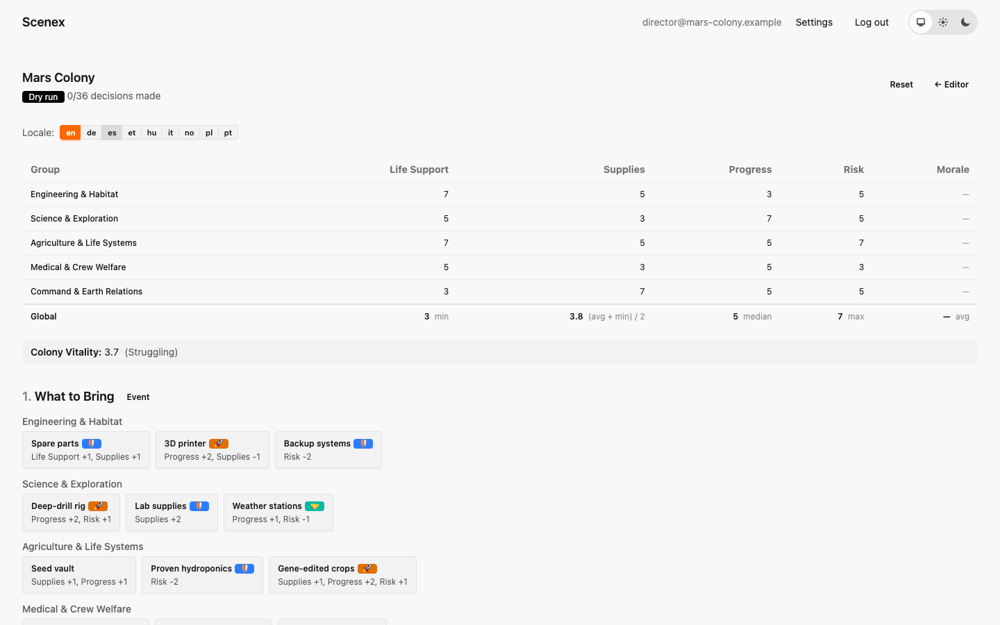
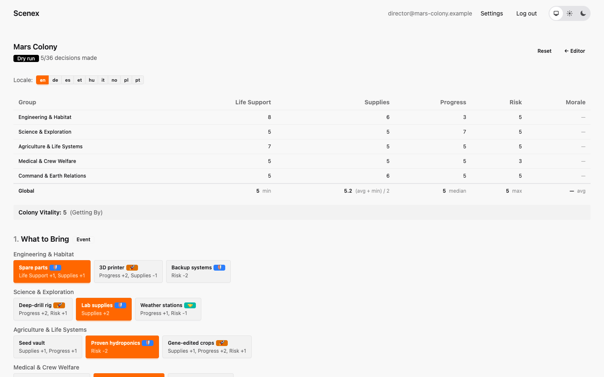
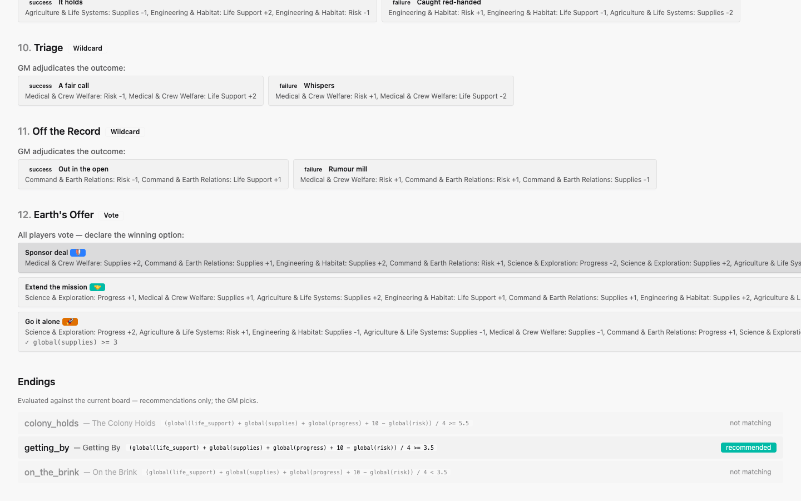

# 8. The dry run

[← Translating a scenario](07-translation.md) · [Contents](index.md) · [Next: Creating a session →](09-sessions.md)

The **Dry run** button in the editor opens a sandbox where you can play the
whole scenario alone, click by click, and watch the numbers. Nothing is saved
— it is a calculator for your design. It uses exactly the same rules as a live
session, so what balances here balances on the night.

At the top is the board: every group's values, the global value with its
formula, and the Overall Index with its current band. Below it, every beat of
the timeline with all options of all groups, including their effects and
gates.

## Playing it through

Click an option to choose it for that group; click again to undo. The board
updates immediately.

Here are the five "cautious" choices of the Prologue. Command's oxygen lifts
the colony's Life Support from 3 to 5 — because Life Support uses `min`, that
single choice moves Colony Vitality from 3.7 (*Struggling*) to 5.0 (*Getting
By*):

Wildcards are adjudicated with their success/failure buttons, Votes by
picking the winning ballot option. **Reset** starts over.

At the bottom, the **Endings** list shows which endings the current board
would recommend:

## What to check

Run the scenario several times with different "personalities":

1. **The careful room** — every group picks the safest option. Do they reach
   your best ending? They should, but not by a mile.
2. **The reckless room** — every group picks the boldest option. Do they end
   badly? They should.
3. **The real room** — a mix. Does it land in the middle?

Also look for:

- options nobody would ever choose, because another option is better in every
  way;
- values stuck at their minimum or maximum (the effects are too big);
- gates that are always open or always closed (then they teach nothing);
- beats that barely move the board — fine for a quiet moment, a problem for
  your crisis.

> **Mars Colony's numbers were checked this way — thousands of times.** A
> script plays the scenario automatically with careful, mixed, random and
> reckless groups and counts which ending each run reaches. The results are
> in [the Mars Colony appendix](mars-colony.md#balance).

---

[← Translating a scenario](07-translation.md) · [Contents](index.md) · [Next: Creating a session →](09-sessions.md)
