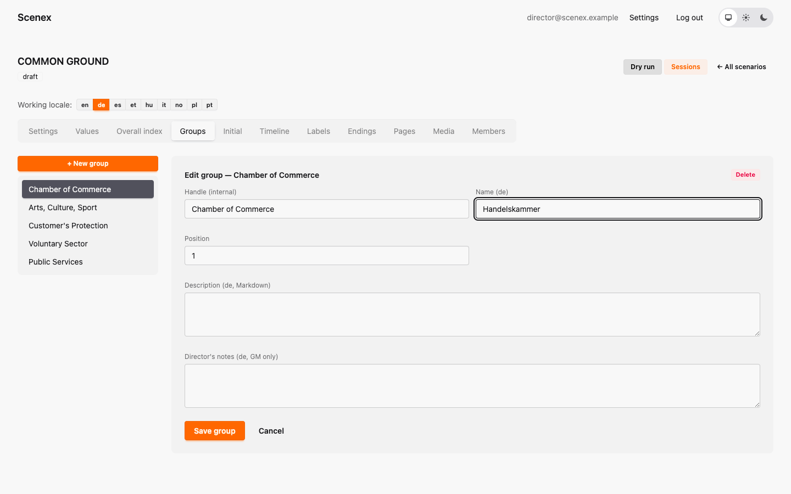
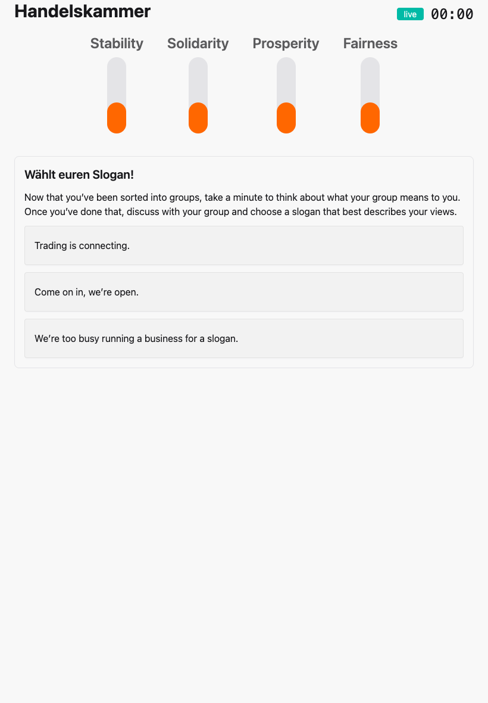

# 8. Your Common Ground

[← Pages, media, endings and more](07-pages-and-more.md) · [Contents](index.md) · [Next: The dry run →](09-dry-run.md)

Every theatre that stages Common Ground plays **the same Common Ground** —
one shared scenario on scenex.org, with all its languages inside. You don't copy it,
you don't rebuild it: you **translate** it, maybe **add** a local touch, and
**perform** it.

## What's shared, what's yours

| Shared by everyone | Yours |
|---|---|
| groups, values, the Democracy Score | your translation |
| every beat, every option, every number | your performances (sessions) |
| the keys (internal names) | your local extra beats, if you want them |

Anything you change in the shared part, **every** theatre gets in its next
performance. So: translate freely, add carefully, and talk to the others
before changing a number.

## Translating

1. Open Common Ground in the editor.
2. In the **Working locale** row, click your language — say `de`.
3. Now every text field shows the German version. Empty means "not
   translated yet". Type your translation and save.

Only **texts** get translated: names, titles, descriptions, pages.
Numbers, formulas, conditions and keys are the same
in every language.

A good order of work:

1. **Group names and value names** — they're on every screen.
2. **Titles and descriptions** of the beats.
3. **Option names** — short! They have to fit on a phone.
4. **Pages.** Common Ground's pages are pictures, some with English text in
   them. Make your own version of the picture, upload it in **Media**, and
   put its link into the page *in your language*.
5. Director's notes — only if your game master needs them in your language.

### Nothing ever goes blank

You don't have to finish before you play. Anything that isn't translated yet
simply shows in English. Here a German session where only the group name and
the first beat's title are translated so far:

### Check your translation

The [dry run](09-dry-run.md) has its own language switch — click through the
whole show in your language and read every text once, on the actual screens.

## Adding a local touch

Want a beat that only your audience will understand — a local scandal, a
Wildcard with a famous local name? Add it to the timeline. Nobody else is
forced to play it: beats only happen when a game master triggers them.

To keep the shared scenario tidy:

- **Start the key with your country or city code** — for example
  `XY · Harbour Festival`. Everyone sees at a glance whose beat it is.
- **Mention it in its director's notes**: *"Local extra — other theatres
  skip this."*
- **Don't change the shared beats.** If you think an option or a number
  should change for everybody, talk to the others first.

## Never translate a key

Keys are the internal names — `Key Event 1`, `Chamber of Commerce`. They
are how all of us find our way around the shared scenario, so **they always
stay in English**.

It has happened: someone translated the group keys into their own
language. Suddenly every other team saw names they couldn't read in their
editor. Easy to fix, but confusing for a while. Translations go into the
**Name** fields of your language — the key field stays as it is.

## Playing in your language

When you create a session, choose your **play language**
([chapter 10](10-sessions.md)). The group boards and the projector then
speak your language — and anything not yet translated appears in English.

---

[← Pages, media, endings and more](07-pages-and-more.md) · [Contents](index.md) · [Next: The dry run →](09-dry-run.md)
