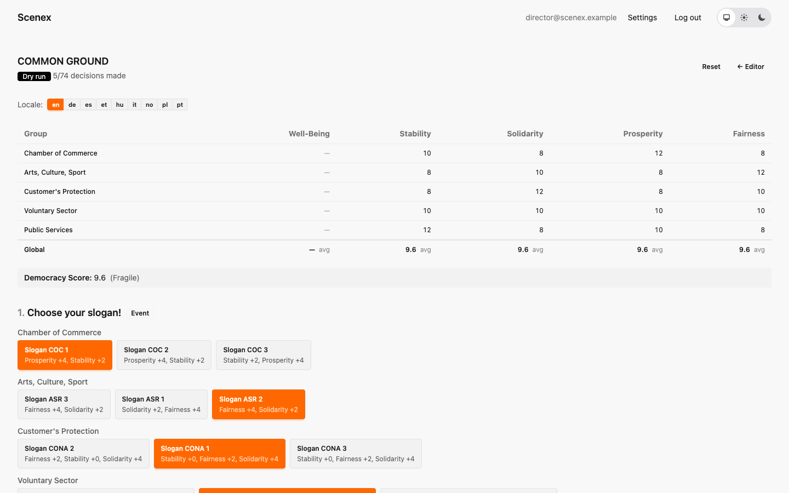

# 9. The dry run

[← Your Common Ground](08-your-common-ground.md) · [Contents](index.md) · [Next: Creating a session →](10-sessions.md)

Before a single player sits down, you can play the whole show on your own.
Click **Dry run** in the editor: you get a sandbox with the scenario's board
at the top and *every* beat with *every* group's options below. Nothing is
saved and nobody sees it — it's your rehearsal room for the numbers.

The board shows each group's values, the global values (with their formula
underneath) and the Democracy Score with its current band.

## Play it through

Click an option to choose it for that group; click it again to take it back.
The numbers update instantly. Wildcards have their *success* / *failure*
buttons; for a Vote, click the winning ballot option.

Here, every group has picked its slogan in *Choose your slogan!*. Every
slogan is worth points, so every global value rises — and the Democracy Score
climbs from 8 to 9.6:

**Reset** clears everything and starts again from the top. The language
switch lets you read the whole show in any translation.

## What to look for

Play the show a few times with different personalities:

- **The careful room** — every group plays it safe. Where do you end up?
- **The bold room** — every group goes for the big gain.
- **The real room** — a mix.

And watch out for:

- an option nobody would ever choose, because another is better in every way;
- a value stuck at its minimum or maximum — the effects are too big;
- a crisis that hardly moves the board;
- a "two versions" beat where it's always the same version that fits.

> 🪐 Mars Colony's numbers were checked thousands of times this way — by a
> script that plays the dry run automatically with careful, mixed and
> reckless rooms. The results are in the [Mars Colony appendix](mars-colony.md).

---

[← Your Common Ground](08-your-common-ground.md) · [Contents](index.md) · [Next: Creating a session →](10-sessions.md)
