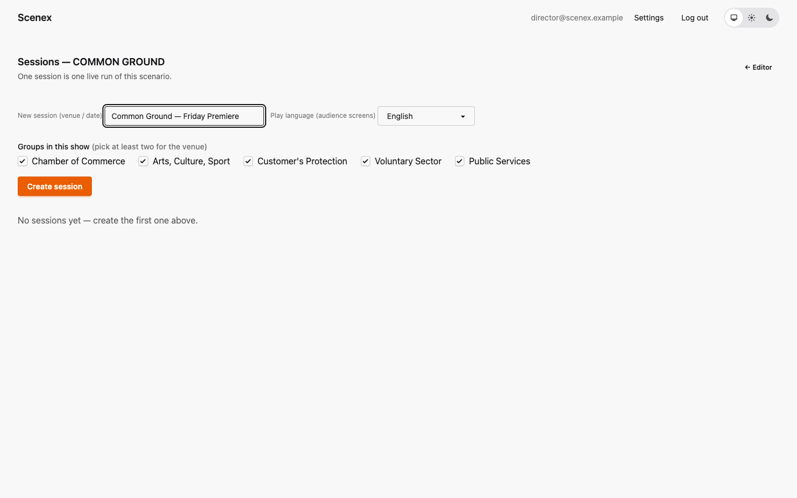
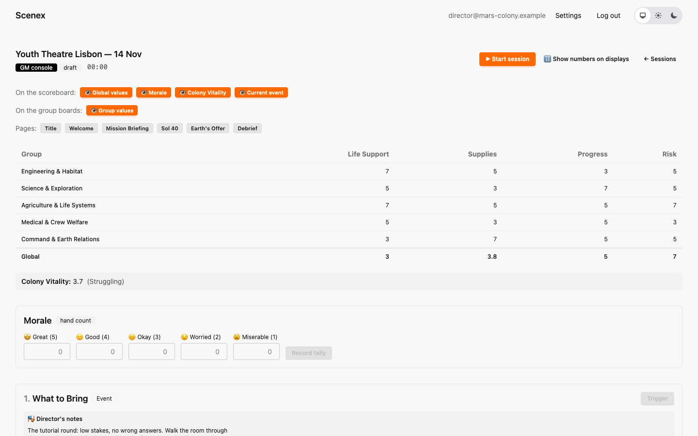
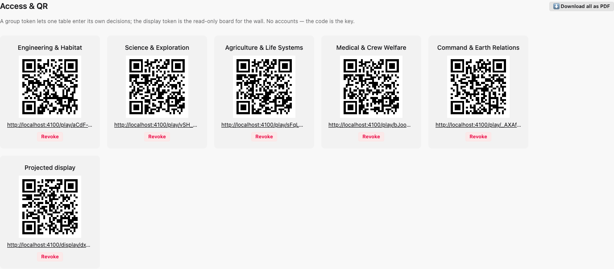
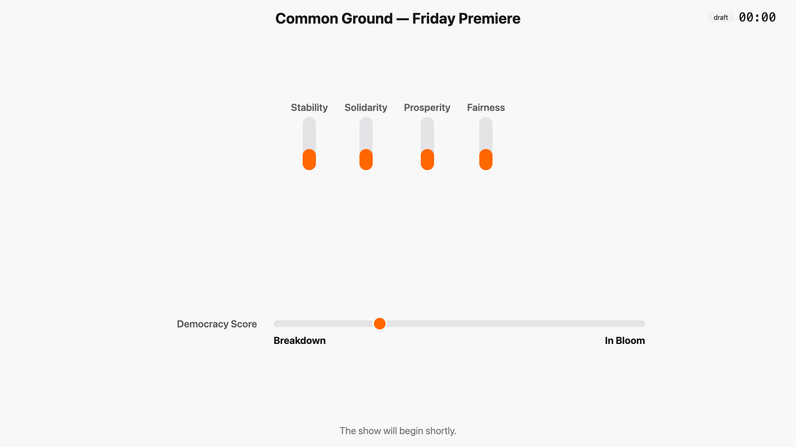

# 9. Creating a session

[← The dry run](08-dry-run.md) · [Contents](index.md) · [Next: Running the show →](10-gm-console.md)

A **session** is one live performance of a scenario. Create a fresh session
for every show — and one for every rehearsal.

## Create it

In the editor, click **Sessions**.

- **New session** — a label for this show, usually venue and date
  ("Youth Theatre Lisbon — 14 Nov"). It is shown at the top of the projected
  display.
- **Play language** — the language of the boards and the display
  ([chapter 7](07-translation.md)).
- **Groups in this show** — which of the scenario's groups are playing
  tonight. A smaller audience can play with fewer groups (at least two). This
  choice is fixed once the session exists.

Click **Create session** and you are in the GM console. You can come back to
it any time from the sessions list (**Open console**).

The session starts as a **draft**: nothing is running, and the game clock is
at 00:00.

## QR codes for the tables and the projector

Scroll down to **Access & QR**. Generate one code per group and one for the
projected display:

- Each code is a link. Whoever opens it gets exactly that group's board (or
  the display) — no account, no password.
- **Download all as PDF** gives you a printable sheet with every code. Print
  it, cut it up, and put each code on its group's table.
- **Revoke** kills a code immediately (for example if a photo of it ends up
  in the wrong place). Generate a new one afterwards.

Open the display link on the computer that drives the projector, in full
screen. Before the session starts, it already shows the starting board, the
session's name and "The show will begin shortly":

Do this before the audience arrives — you can show the *Title* or *Welcome*
page while people find their seats.

---

[← The dry run](08-dry-run.md) · [Contents](index.md) · [Next: Running the show →](10-gm-console.md)
