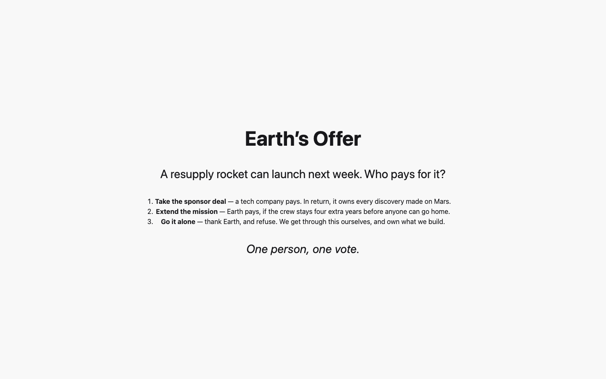
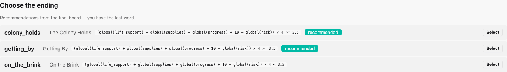

# 10. Running the show from the GM console

[← Creating a session](09-sessions.md) · [Contents](index.md) · [Next: What the room sees →](11-player-screens.md)

The GM console is the game master's cockpit. It shows every number — including
the ones players never see — and every control. This chapter follows one
Mars Colony session from the first slide to the ending.

## The top of the console

- **▶ Start session / ⏸ Pause / ▶ Resume / ⏹ End** — the session's status
  and its **game clock**. All deadlines run on the game clock, so pausing
  freezes every countdown.
- **🔢 Show numbers on displays** — by default the projector and the group
  boards show values as bars without numbers. This switch adds the numbers.
  The console always shows them.
- **On the scoreboard** — switch individual parts of the projected display on
  or off: the global values, each per-participant value (Morale), the Overall
  Index, the current event.
- **On the group boards** — hide the groups' own values, e.g. for a round
  where they should decide "blind".
- **Value changes → ✓ Consolidate now** — the boards mark what changed since
  the last beat. Firing the next beat resets those markers automatically; this
  button does it earlier.
- **Pages** — one button per page. Clicking it puts the page on the
  projected display; **◼ Back to scoreboard** removes it. Pages work at any
  time, even before the session starts.

## Before the show: pages

While the audience arrives, put up the *Title* page — a single full-screen
image from the media library:

When people sit down, switch to *Welcome*, which tells them what to do:

## Starting

Click **▶ Start session**. The clock starts, and the live board shows every
group's numbers, the global values and the Overall Index with its exact
value and band:

## Firing an Event

Below the board, every beat of the timeline has its own card with its
director's notes. Click **Trigger** on *What to Bring*. Now:

- every group board shows the narrative and that group's options;
- the projected display shows the title and the countdown;
- the console shows one row of option buttons per group.

Groups decide on their own boards. You can also enter a decision for any
group yourself by clicking its option in the console — useful for a table
without a device, or to correct a mistake. **The last decision counts.**

When every group has decided, the card says **decided**. The board above
shows each recent change next to the number (for as many seconds as the
scenario's *change highlight* setting):

### Deadlines

*What to Bring* and *The Storm* have deadlines. The countdown appears on the
card, on the boards and on the display:

When time runs out, every group that hasn't decided gets its **default**
option. Groups without a default stay undecided — you can still decide for
them.

**⏹ Close event** stops a beat early. Closing never applies defaults; it only
marks the beat as finished.

### Gates

The console shows each gated option with its condition. Gates lock options on
the group boards, never in the console — you can always override.

## Counting Morale

At the end of Act 1, ask the room: *"Hands up — how are you feeling about
life in the colony right now?"* Count each step and type the numbers into the
Morale box:

**Record tally** puts the average on the projected display. Every count is
kept with its time, so you can see how the mood changed during the evening:

## Wildcards

Hand the mission card to one player (the director's notes say who). Trigger
the Wildcard in the console when you want it to be "live", and adjudicate when
you know how it went — **success** or **failure**:

## Two versions of a beat

*The Storm* hits; Command calls Earth. Then Mars Colony's director's notes
tell you to choose between two versions of *Rationing* according to Colony
Vitality. Fire only the one that fits:

## Votes

Put up the *Earth's Offer* page so the room can read the three options:

Give the teams time to campaign, then trigger the Vote and count hands for
each option. Enter the counts, select the winner, and click **Declare
result**:

The winner and the counts appear on the projected display, and the outcome
matrix moves every group's values.

## Ending the game

Click **⏹ End**. Decisions close, and the console lists the endings. Those
whose condition matches the final board are marked **recommended**:

Click **Select** on the ending you want — usually a recommended one, but
that is your call. The projected display shows it, and the session is over.
Put up the *Debrief* page when the room is ready to talk.

## Mistakes happen

- **Wrong option entered?** Click the right one. The last decision counts,
  and every number is recalculated.
- **Wrong Wildcard outcome or vote winner?** The same: adjudicate or declare
  again.
- **Server restarted, laptop crashed?** Open the console again. The session
  replays its record and is exactly where it was.
- **A group's device died?** Enter its decisions from the console, or open
  the group's code on another device.

---

[← Creating a session](09-sessions.md) · [Contents](index.md) · [Next: What the room sees →](11-player-screens.md)
