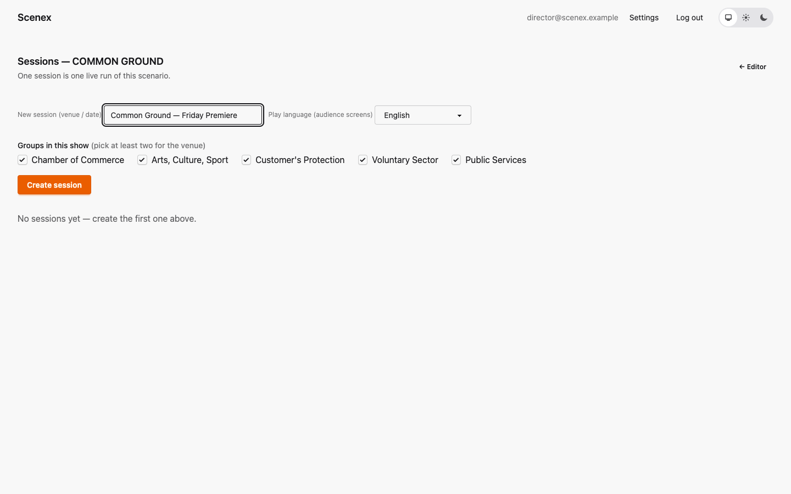
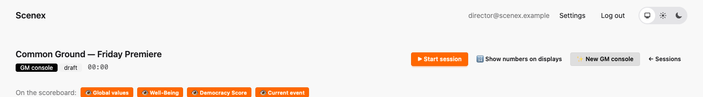
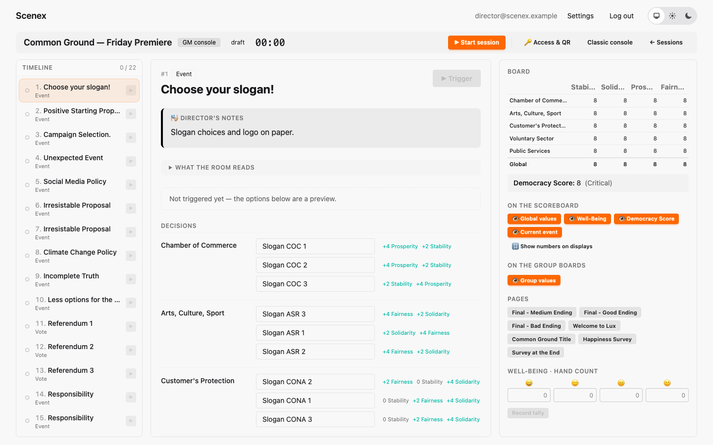
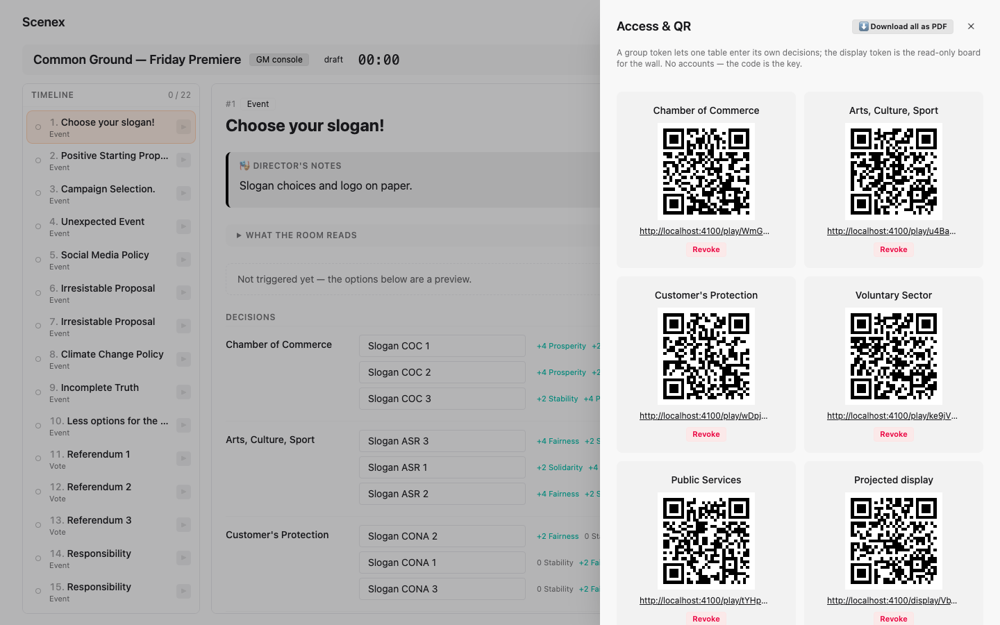
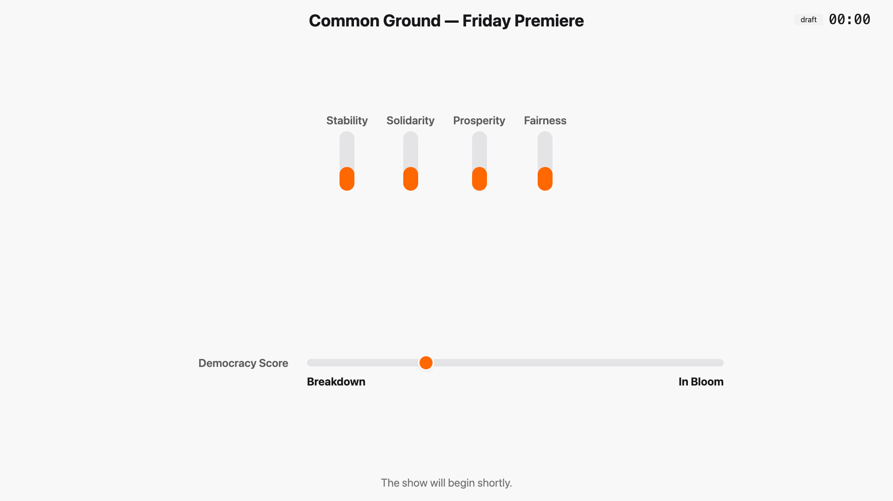

# 10. Creating a session

[← The dry run](09-dry-run.md) · [Contents](index.md) · [Next: Running the show →](11-running-the-show.md)

A **session** is one performance. Make a fresh one for every show — and one
for every rehearsal. Sessions cost nothing, and each keeps its own record.

## Create it

In the editor, click **Sessions**:

- **New session** — a name for this performance, usually venue and date. It
  appears at the top of the projector.
- **Play language** — the language of the group boards and the projector.
- **Groups in this show** — which groups play tonight. A smaller audience can
  play with fewer groups (at least two). This can't be changed later.

Click **Create session**, and you're in the **GM console**. The session is a
*draft*: nothing runs yet, the clock shows 00:00. You can always come back
to it from the sessions list (**Open console**).

## The new GM console

Scenex has two GM consoles at the moment: the **classic** one — one long page
— and the **new** one, which keeps everything on one screen. For a while both
are around; the classic one will be retired. This tutorial uses the new one.

If your console opens as the classic one, click **✨ New GM console** at the
top:

The new console has a **Classic console** button too, if you ever need to go
back.

## QR codes for the tables and the projector

Click **🔑 Access & QR** in the top bar. A panel slides in: make one code for
every group and one for the projector:

- Each code is a link. Whoever opens it gets exactly that group's board —
  or the projector view. No account, no password.
- **Download all as PDF** gives you one printable sheet with all codes. Print
  it, cut it up, put each code on its group's table.
- **Revoke** switches a code off immediately (say, a photo of it landed on
  social media). Make a new one afterwards.

## Set up the projector

Open the projector link on the computer connected to the projector, and go
full screen. Before the show starts, it already shows the starting board and
"The show will begin shortly":

Even before you start, you can put up a page — the *Common Ground Title* is a
nice thing to look at while people arrive.

---

[← The dry run](09-dry-run.md) · [Contents](index.md) · [Next: Running the show →](11-running-the-show.md)
