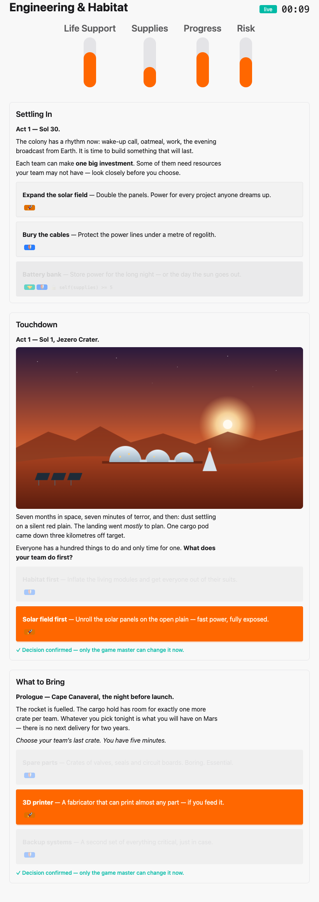
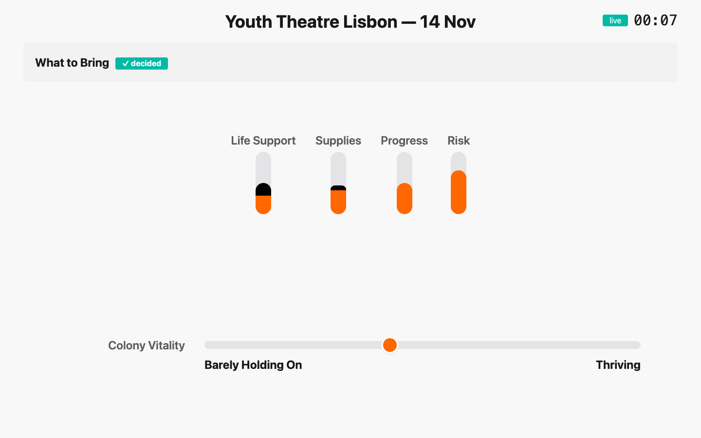
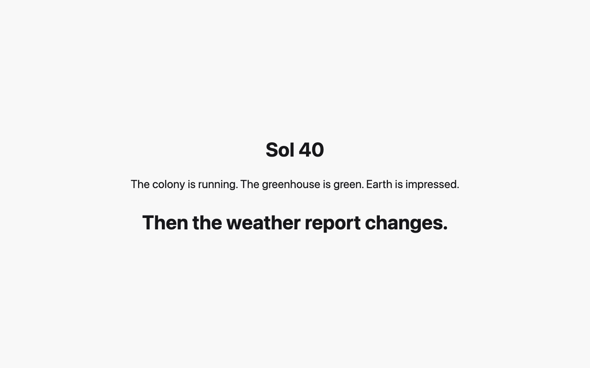

# 11. What the room sees

[← Running the show](10-gm-console.md) · [Contents](index.md) · [Next: Show-day checklist →](12-show-day.md)

Players only ever see two screens. Knowing exactly what is on them helps you
write content and run the show.

## The group board

One device per table, opened with that group's QR code. It works on phones,
but a tablet is more comfortable for a table of five.

Before the first beat it shows only the group's values, as bars:

When the GM fires an Event, the board shows the narrative and **only this
group's options**, with their labels and the countdown:

Choosing is a two-step action, so a stray tap doesn't decide for the whole
table:

After confirming, the choice is locked for the table — only the game master
can change it now. Earlier beats stay below, newest first:

A **gated** option stays visible but greyed out, with the condition the group
didn't meet. Here Engineering cannot afford the *Battery bank*
(`self(supplies) >= 5`) because it spent its supplies on a 3D printer and a
solar field:

Votes and Wildcards don't appear on group boards: votes happen by show of
hands in the room, Wildcards are secret missions for one person.

## The projected display

The display is for everyone. It never shows a single group's numbers — only
the colony as a whole.

- the session label, its status and the game clock;
- the current beat and its countdown;
- the **global values** as bars — after a decision, the part that changed is
  marked until the next beat (a dark cap for a rise, a dashed outline for a fall);
- each **per-participant value** (Morale) after its first count, with its
  emoji;
- the **Overall Index** as a dot between the worst and best band labels. The
  display never shows the exact score or the band name in between — the
  room should feel the trend, not do maths.

After the Prologue, the bars have moved and Colony Vitality has climbed out
of *Struggling*:

While a Vote is open, the display only shows its title and countdown — the
options are presented in the room (Mars Colony uses a page for that):

After the Vote, the display shows the winner and the counts:

Pages take over the whole display:

And at the end, the chosen ending:

---

[← Running the show](10-gm-console.md) · [Contents](index.md) · [Next: Show-day checklist →](12-show-day.md)
