# 11. Running the show

[← Creating a session](10-sessions.md) · [Contents](index.md) · [Next: What the room sees →](12-what-the-room-sees.md)

The GM console is your prompt book and your lighting desk in one. Let's walk
through an evening of Common Ground with it — from the first picture on the
wall to the finale.

> This chapter shows the **GM console** you open from the sessions list
> ([chapter 10](10-sessions.md#the-gm-console)). The classic one-long-page
> console is still reachable via **Classic console** and will be retired.

## The console at a glance

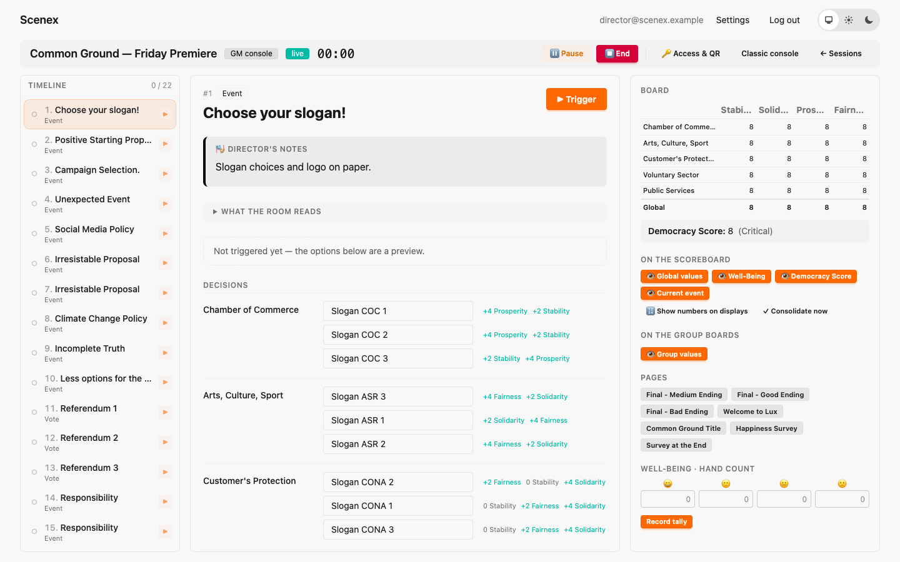

The console fills the screen and never scrolls away from you. It has three
areas under one top bar:

- **The top bar** — the session's name, its status and the **game clock**,
  and the buttons you need in an emergency: **▶ Start / ⏸ Pause / ▶ Resume /
  ⏹ End**. Every countdown runs on the game clock; pause, and they all
  freeze. **🔑 Access & QR** opens the codes for the tables and the projector
  ([chapter 10](10-sessions.md#qr-codes-for-the-tables-and-the-projector)).
- **The timeline (left)** — every beat of the show, in order. A **▶** next to
  a beat triggers it straight away; clicking its name opens it in the middle.
  A tick marks a finished beat, *3/5 decided* shows how far a beat has got,
  and a running countdown is shown right there.
- **The beat (middle)** — the beat you've selected: its director's notes,
  *What the room reads* (the text on the boards), and below that the
  decisions — every group with its options and what each option does to the
  numbers.
- **The room (right)** — everything about the screens in the room:

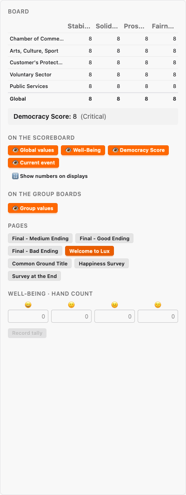

- **Board** — every group's numbers, the global values, and the Democracy
  Score with its exact value and band.
- **On the scoreboard** — switch parts of the projector on or off: the
  values, Well-Being, the Democracy Score, the current beat.
  **🔢 Show numbers on displays** adds numbers to the bars on the projector and
  the boards (the console always shows them). **✓ Consolidate now** resets the
  "what changed" marks on the screens right away (the next beat does that
  too).
- **On the group boards** — hide the groups' own numbers, e.g. for a round
  where they should decide "blind".
- **Pages** — one button per page. One click puts it on the projector;
  **◼ Back to scoreboard** takes it down. Works any time, even before the
  start.
- **Well-Being · hand count** — for asking the room (see below).

On a smaller screen the room panel slides in from the side: click
**📺 The room** in the top bar.

## Before the doors open

Put up the title while people come in:

When everyone has found a table, switch to *Welcome to Lux*:

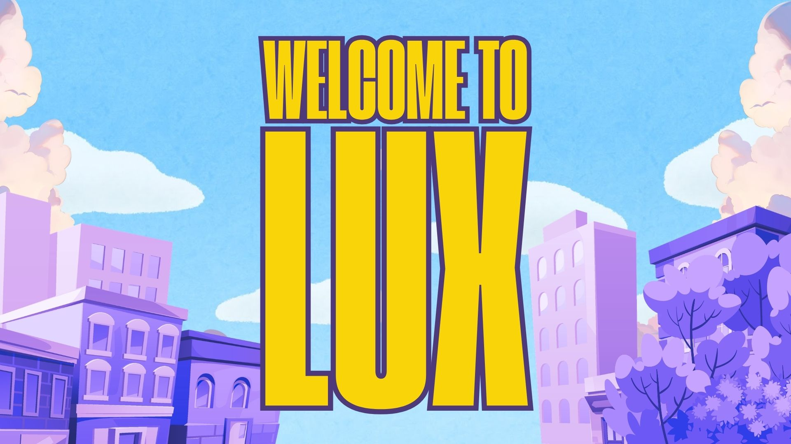

## Curtain up

Click **▶ Start session**. The clock starts. The first beat, *Choose your
slogan!*, is already selected in the middle.

## The warm-up: choose your slogan

Click **▶ Trigger**. Now every table's board shows the question and its own
three slogans:

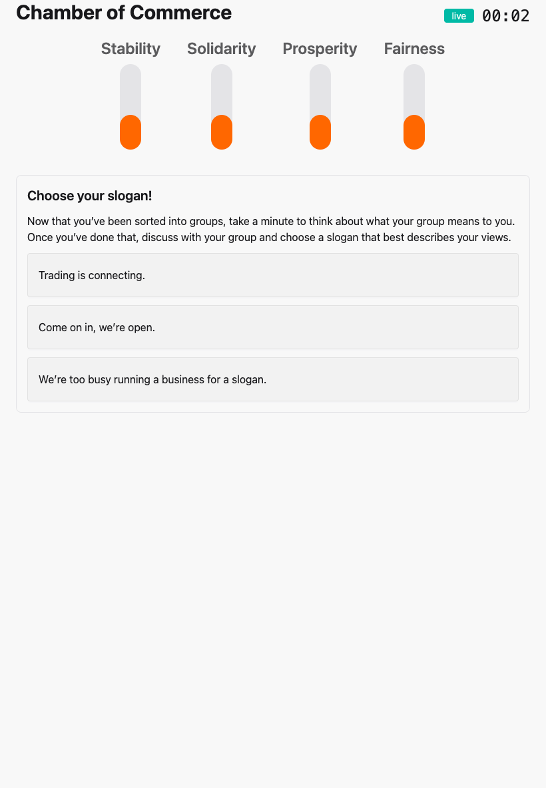

A group taps a slogan, and confirms — two steps, so nobody decides for the
table by accident:

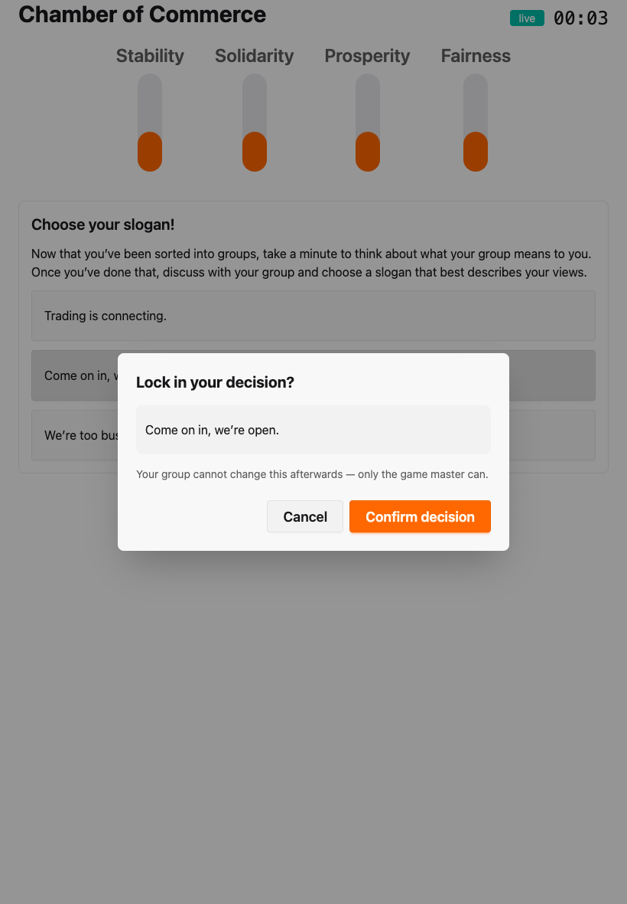

In the console you see every decision arrive — the chosen option lights up,
and the group gets a tick. You can also click an option yourself — for a
table without a device, or to fix a mistake. **The last decision always
counts.**

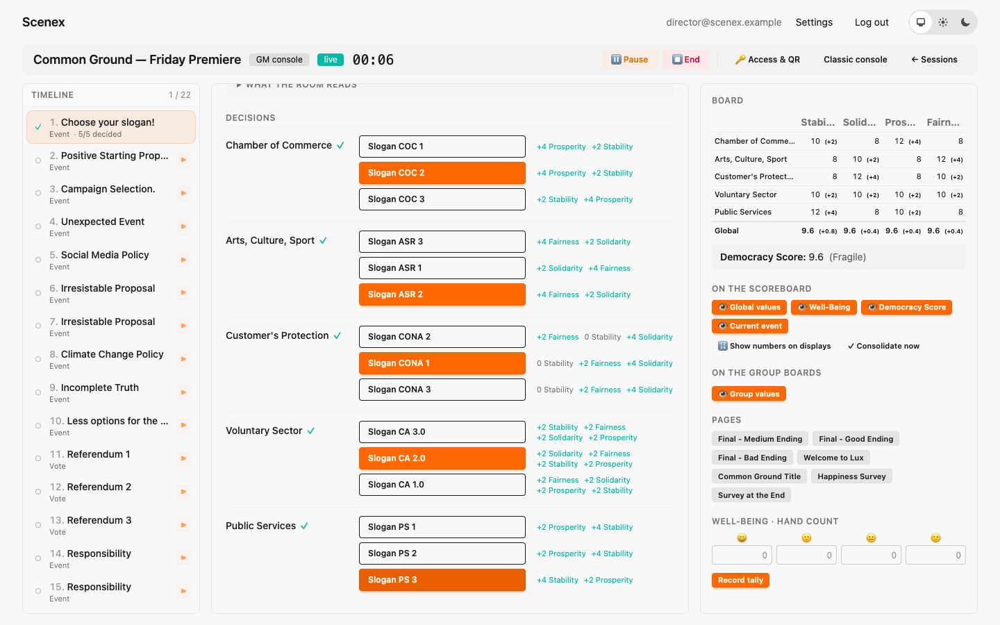

The board in the room panel shows what changed:

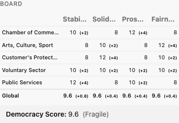

…and so does the projector:

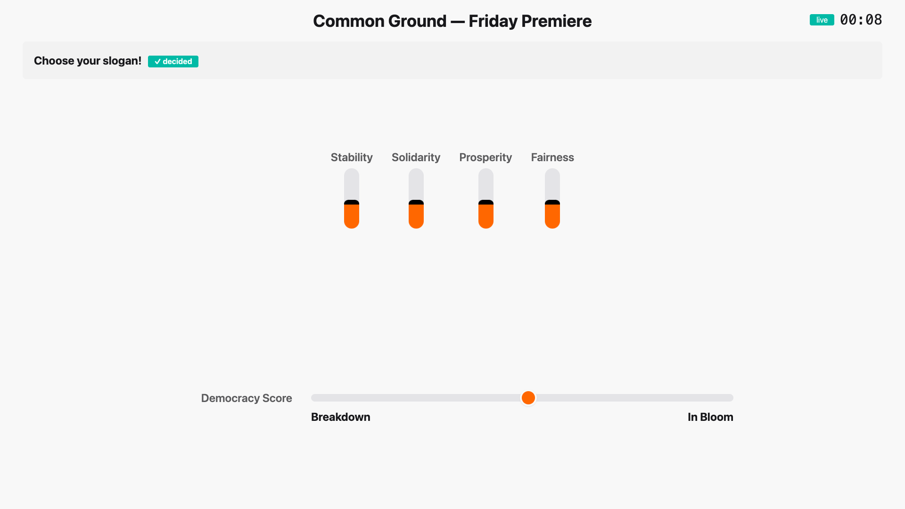

### Showing the room what everyone chose

Above the decisions, three buttons belong to the beat:

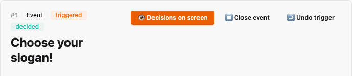

- **Decisions on screen** — the projector shows each group with the option
  it chose (a group still deciding shows "…"):

  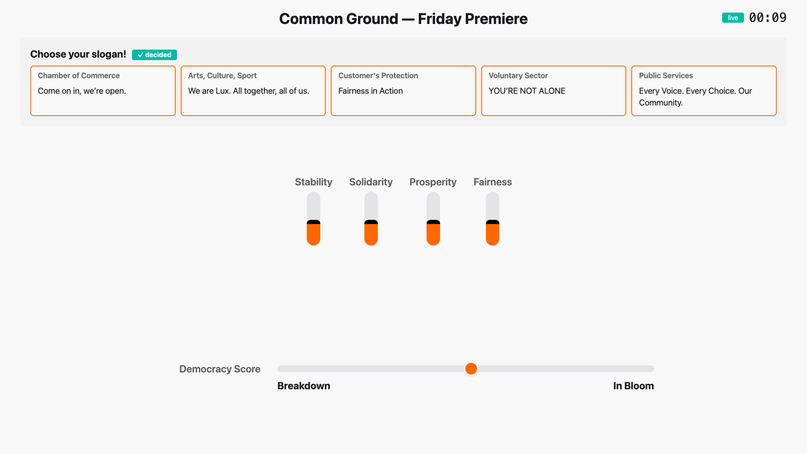

  Closing the event leaves the decisions up, so the room can talk about them;
  they come down when you switch them off or trigger the next beat.
- **⏹ Close event** — ends a beat early. It never chooses anything for
  anyone.
- **↩ Undo trigger** — triggered the wrong beat? This puts it back as if you
  had never clicked: its decisions are discarded (the console asks first and
  says how many), the board reverts, and you can trigger it again when its
  moment comes — with a fresh deadline.

## Asking the room

Time for a reality check. Put up the *Happiness Survey* page:

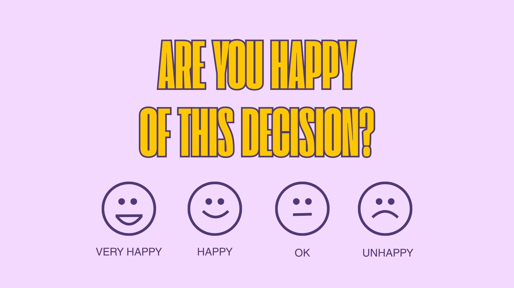

Count the hands for each answer and type the numbers into *Well-Being · hand
count* in the room panel:

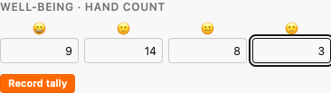

**Record tally**, and the room's mood appears on the projector as an emoji.
Every count is kept with its time, so you can see how the mood changed during
the evening:

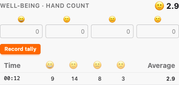

## A Key Event, against the clock

*Positive Starting Proposal* has a five-minute deadline. When you trigger
it, the countdown runs in the console, on every board and on the projector:

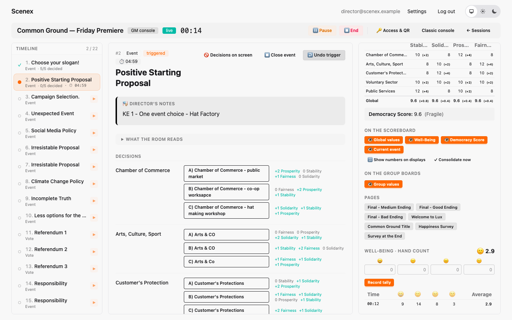

When time runs out, the groups' boards stop taking decisions. A group
without a decision simply stays undecided — Common Ground has no default
options. You can still enter a decision for them.

In a scenario with default options, the console shows **⏱ Time's up** on the
beat, listing the default for each group that hasn't decided. Nothing is
entered until you click **Apply defaults** — or you enter a different
decision yourself, or let the group finish.

## Choosing the right version

Later in the evening comes *Irresistible Proposal* — in two versions, which
sit next to each other in the timeline. Look at the Democracy Score in the
room panel, read the director's notes, and trigger **only** the version that
fits:

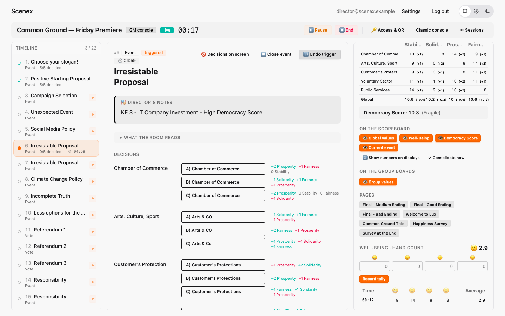

## The Freeze Card

One person keeps talking over their whole group? Hand them the Freeze Card.
Trigger the Wildcard, and when the event is over, judge: did they hold back?
**success**. Did they interfere? **failure**.

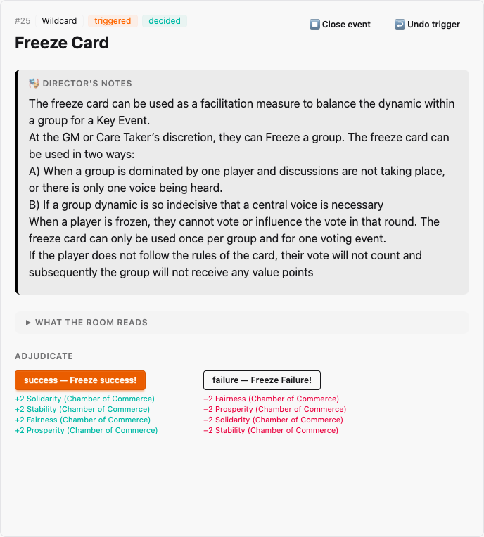

A Wildcard starts **secret**: the projector keeps showing the beat before it,
so only you and the player know. If the whole room should know, click
**On screen** on the Wildcard.

## The Referendum

Let the candidates make their speeches, then trigger the referendum. When the
room should see what's on the ballot, click **Options on screen** — the
projector lists the options:

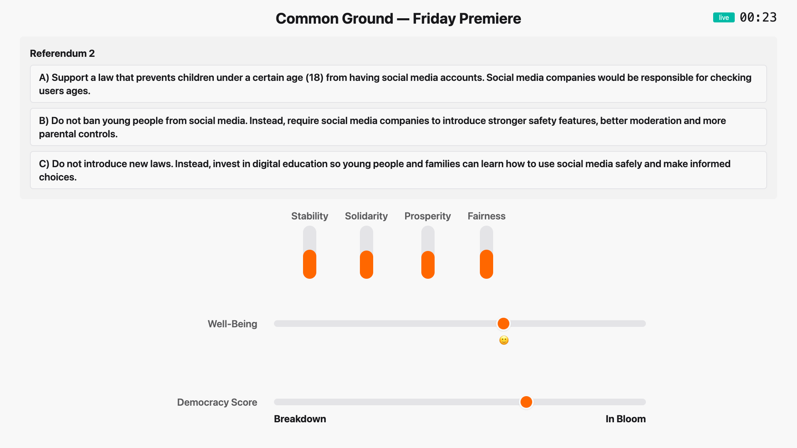

Count the hands for each option, type in the numbers, pick the winner, and
click **Declare result**:

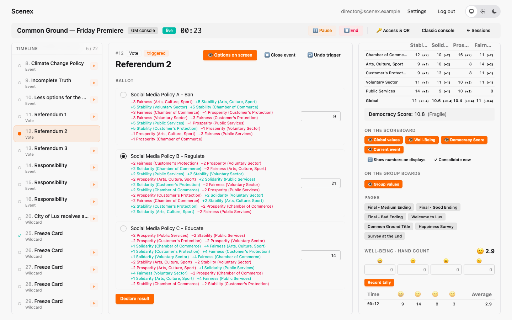

On the projector the winner lights up among the options, with the counts;
the others fade. The outcome matrix moves every group's numbers. Closing the
vote takes it off the projector.

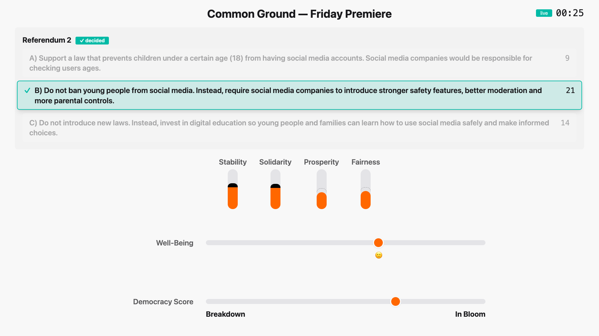

## The finale

Click **⏹ End**. Decisions close, and at the bottom of the timeline appears
**🏁 Choose the ending**. It lists the scenario's endings and marks the ones
that match the final numbers as *recommended* — you pick. 🪐 Here Mars
Colony, whose endings are recommended by its score:

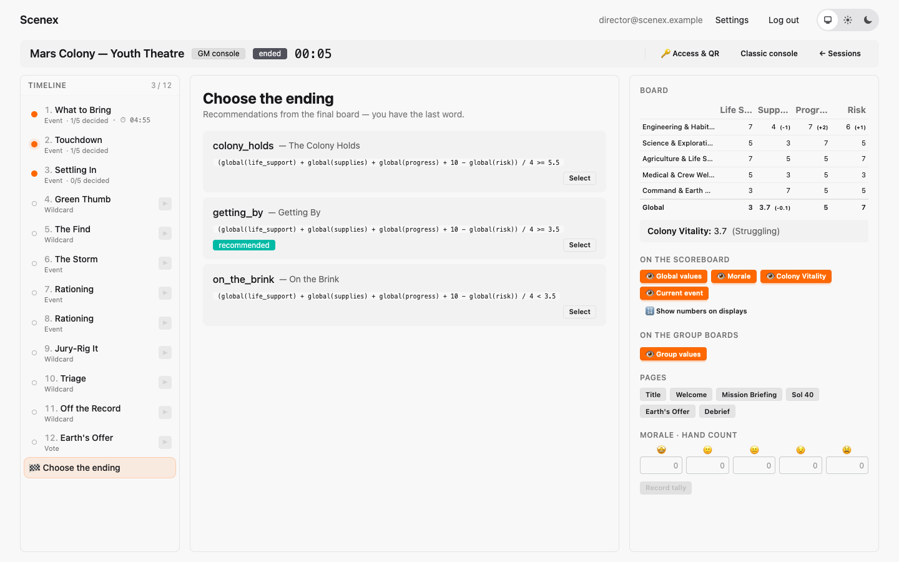

Common Ground does its finale with pages instead: look at the Democracy
Score, and put up the good, the medium or the bad ending.

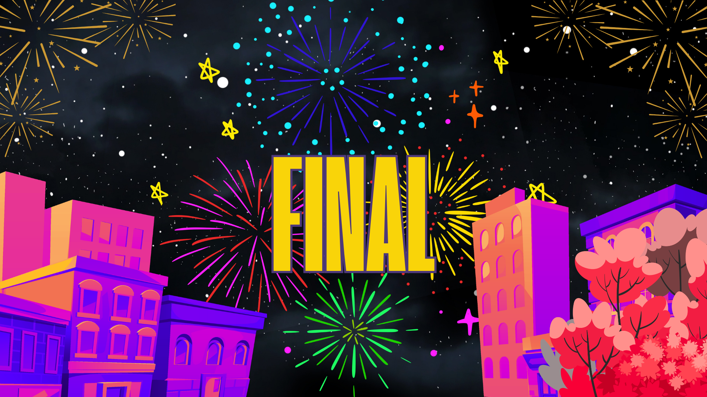

Then: *Survey at the End*, lights up, and talk.

## When things go wrong

| Problem | What to do |
|---|---|
| A group tapped the wrong option | Click the right one in the console — the last decision counts. |
| You triggered the wrong beat | **↩ Undo trigger** on that beat. |
| You judged a Wildcard or a vote wrongly | Judge or declare again. |
| A tablet died | Enter that group's decisions in the console, or open its code on another device. |
| The projector froze | Reload it. Nothing is lost. |
| Your laptop crashed | Open the console again from the sessions list. Everything is still there, exactly as it was. |
| You're running out of time | Skip beats. The list is a menu, not a railway. |

---

[← Creating a session](10-sessions.md) · [Contents](index.md) · [Next: What the room sees →](12-what-the-room-sees.md)
