# 11. Running the show

[← Creating a session](10-sessions.md) · [Contents](index.md) · [Next: What the room sees →](12-what-the-room-sees.md)

The GM console is your prompt book and your lighting desk in one. Let's walk
through an evening of Common Ground with it — from the first picture on the
wall to the finale.

## The top of the console

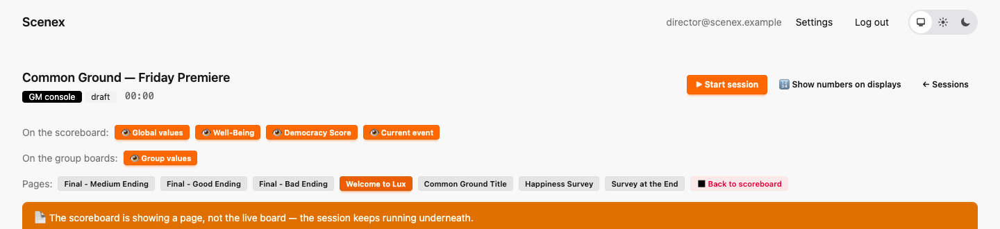

- **▶ Start / ⏸ Pause / ▶ Resume / ⏹ End** — the show's status and its
  **game clock**. Every countdown runs on that clock; pause, and they all
  freeze.
- **🔢 Show numbers on displays** — normally the projector and the boards show
  bars without numbers. Switch this on if you want numbers too. The console
  always shows them.
- **On the scoreboard** — switch parts of the projector on or off: the
  values, Well-Being, the Democracy Score, the current beat.
- **On the group boards** — hide the groups' own numbers, e.g. for a round
  where they should decide "blind".
- **Value changes → ✓ Consolidate now** — after a decision, the screens mark
  what changed. Firing the next beat resets those marks; this button does it
  right away.
- **Pages** — one button per page. One click puts it on the projector;
  **◼ Back to scoreboard** takes it down. Works any time, even before the
  start.

## Before the doors open

Put up the title while people come in:

When everyone has found a table, switch to *Welcome to Lux*:

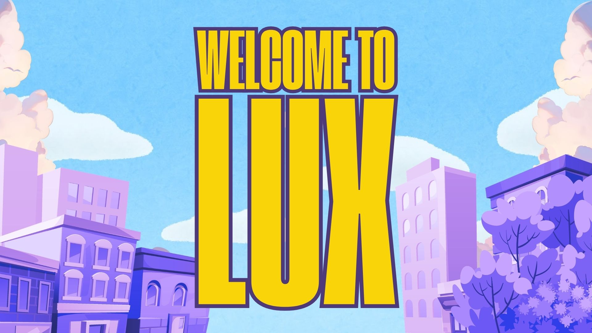

## Curtain up

Click **▶ Start session**. The clock starts. Below the top bar you see the
live board — every group's numbers, the global values, and the Democracy
Score with its exact value and band:

Below the board, every beat of the timeline has its own card, with its
director's notes right there.

## The warm-up: choose your slogan

Click **Trigger** on *Choose your slogan!*. Now every table's board shows
the question and its own three slogans:

A group taps a slogan, and confirms — two steps, so nobody decides for the
table by accident:

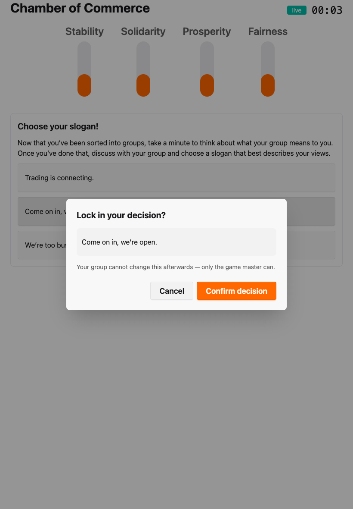

In the console you see every decision arrive. You can also click an option
yourself — for a table without a device, or to fix a mistake. **The last
decision always counts.**

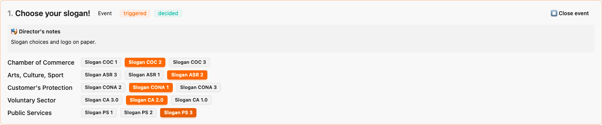

The board at the top shows what changed:

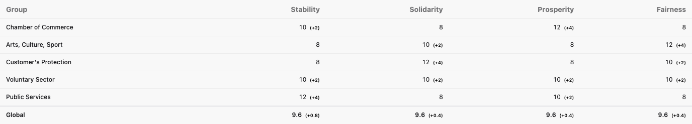

…and so does the projector:

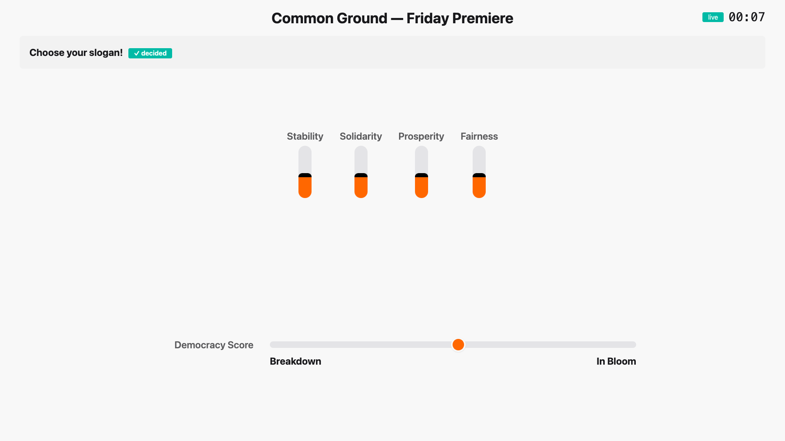

## Asking the room

Time for a reality check. Put up the *Happiness Survey* page:

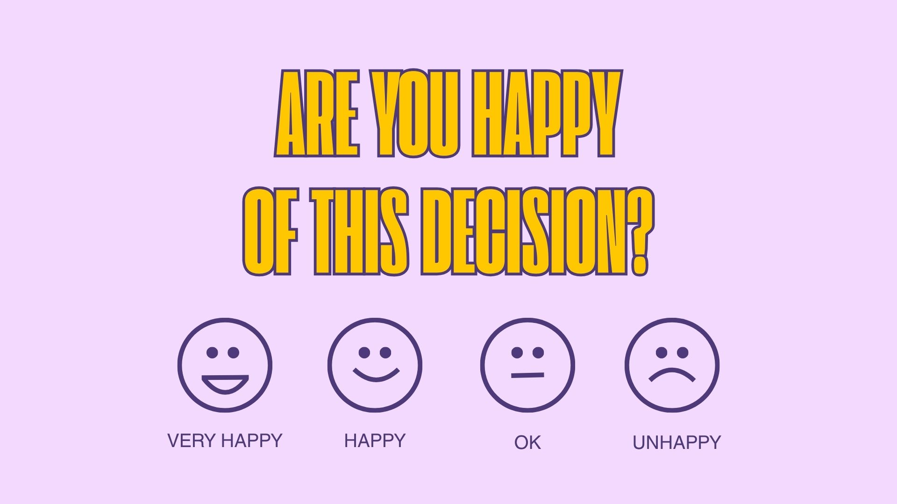

Count the hands for each answer and type the numbers into the Well-Being
box:

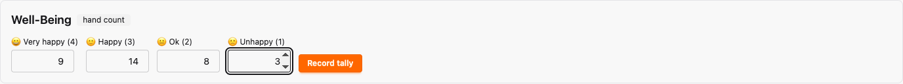

**Record tally**, and the room's mood appears on the projector as an emoji.
Every count is kept with its time, so you can see how the mood changed during
the evening:

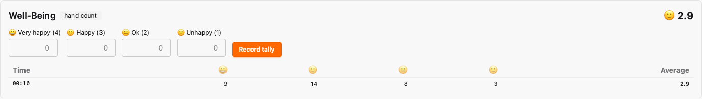

## A Key Event, against the clock

*Positive Starting Proposal* has a five-minute deadline. When you trigger
it, the countdown runs in the console, on every board and on the projector:

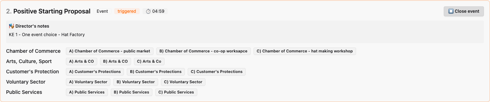

When time runs out, a group without a decision simply stays undecided —
Common Ground has no default options. You can still enter a decision for them.
**⏹ Close event** ends a beat early; it never chooses anything for anyone.

## Choosing the right version

Later in the evening comes *Irresistible Proposal* — in two versions. Look at
the Democracy Score on the console, read the director's notes, and trigger
**only** the version that fits:

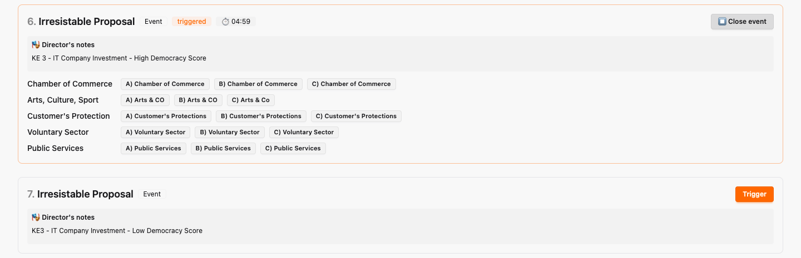

## The Freeze Card

One person keeps talking over their whole group? Hand them the Freeze Card.
Trigger the Wildcard in the console, and when the event is over, judge:
did they hold back? **success**. Did they interfere? **failure**.

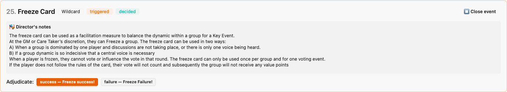

## The Referendum

Let the candidates make their speeches, then trigger the referendum. Count
the hands for each option, type in the numbers, pick the winner, and click
**Declare result**:

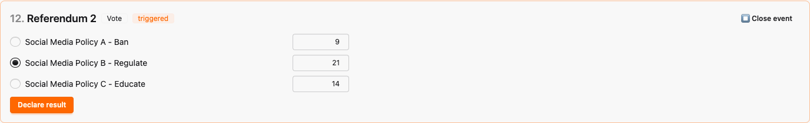

The projector announces the result, and the outcome matrix moves every
group's numbers:

## The finale

Click **⏹ End**. Decisions close, and the console lists the scenario's
endings — with the ones that match the final numbers marked *recommended*
(see [Endings](07-pages-and-more.md#endings)). Common Ground does its finale
with pages: look at the Democracy Score, and put up the good, the medium or
the bad ending.

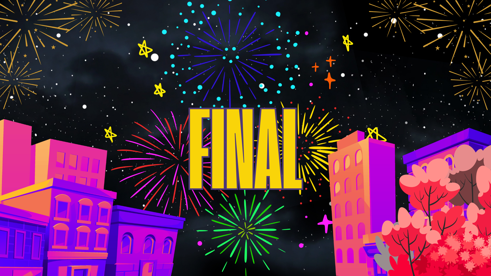

Then: *Survey at the End*, lights up, and talk.

## When things go wrong

| Problem | What to do |
|---|---|
| A group tapped the wrong option | Click the right one in the console — the last decision counts. |
| You judged a Wildcard or a vote wrongly | Judge or declare again. |
| A tablet died | Enter that group's decisions in the console, or open its code on another device. |
| The projector froze | Reload it. Nothing is lost. |
| Your laptop crashed | Open the console again from the sessions list. Everything is still there, exactly as it was. |
| You're running out of time | Skip beats. The list is a menu, not a railway. |

---

[← Creating a session](10-sessions.md) · [Contents](index.md) · [Next: What the room sees →](12-what-the-room-sees.md)
