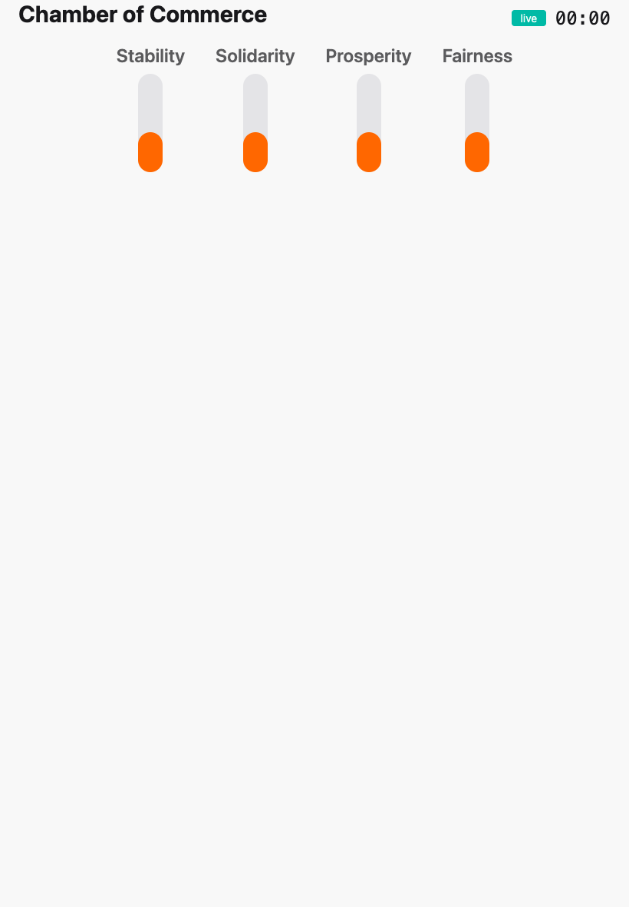
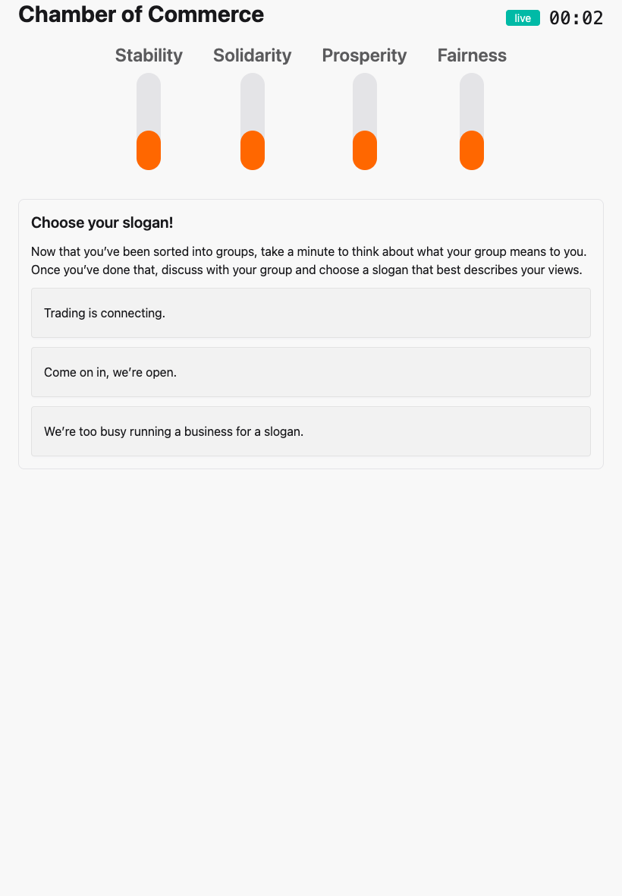
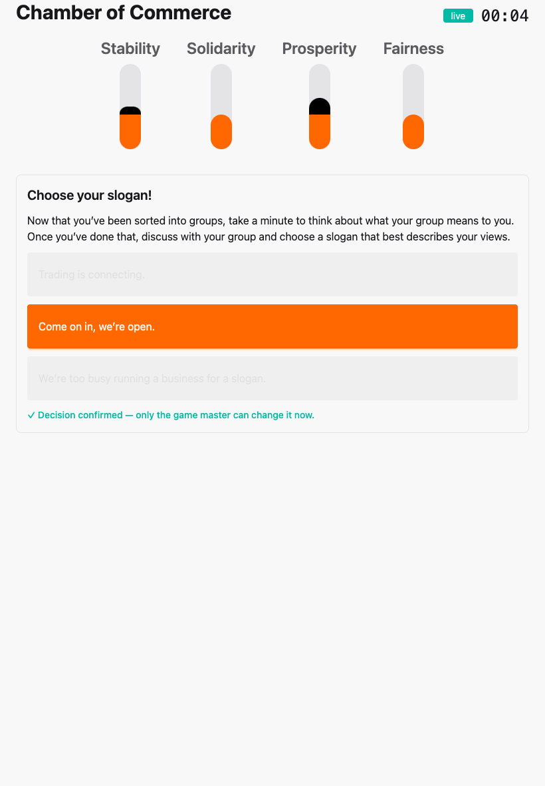
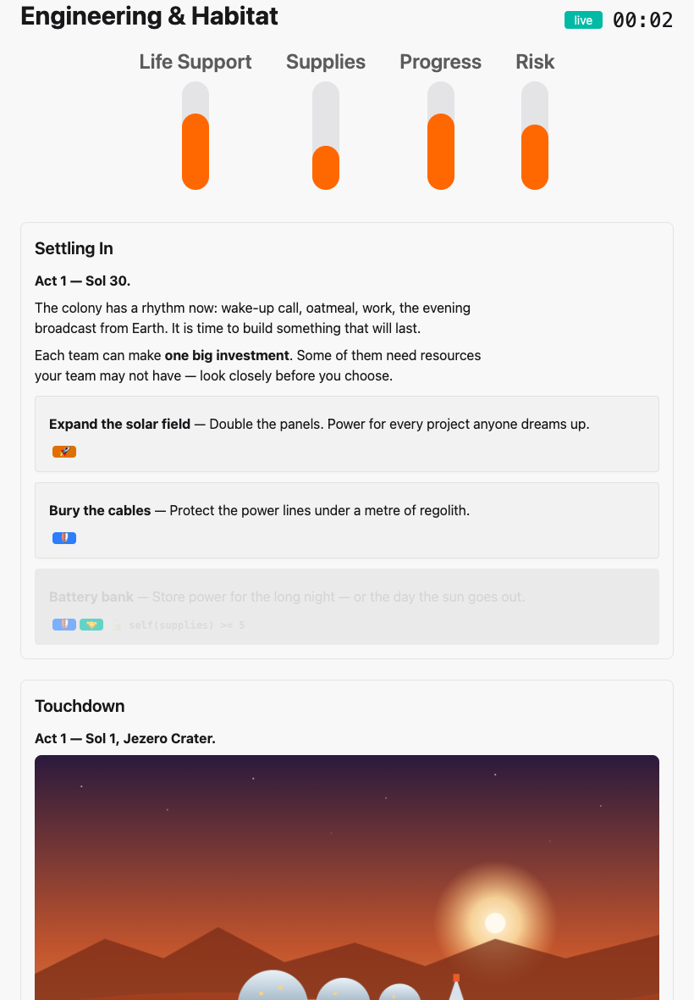
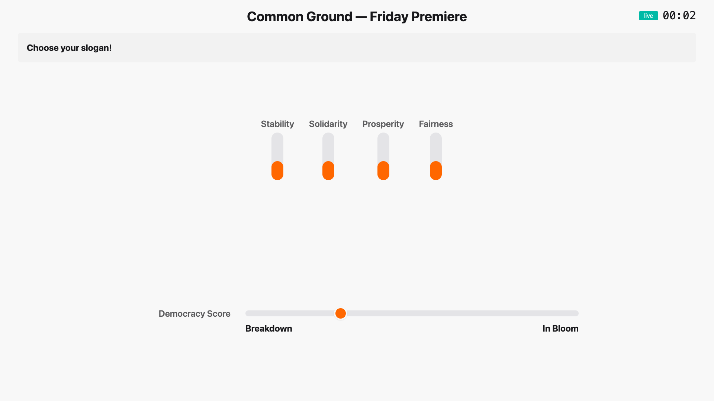
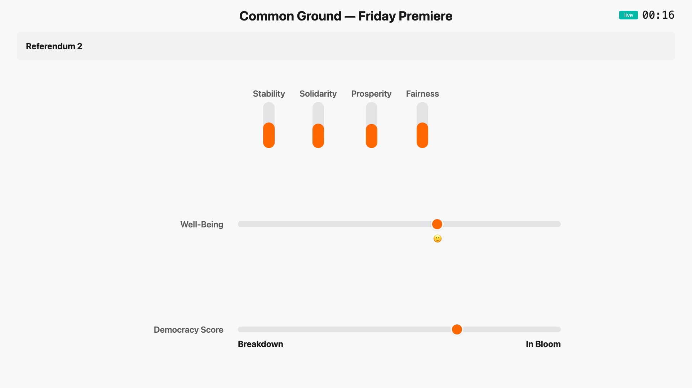
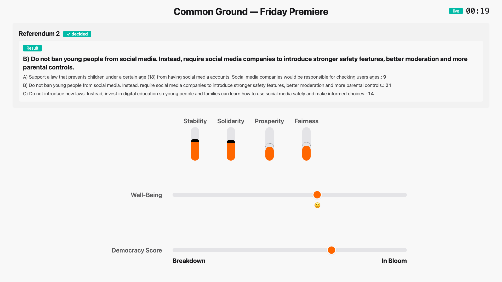

# 12. What the room sees

[← Running the show](11-running-the-show.md) · [Contents](index.md) · [Next: Show-day checklist →](13-show-day.md)

Players only ever see two screens. Knowing exactly what's on them helps you
write, and helps you direct.

## The group board

One device per table — a tablet is ideal, a phone works. Before the first
beat it shows only the group's own values, as bars:

When the game master fires an Event, the board shows the story and **only
this group's options**, plus the countdown if there is one:

After confirming, the choice is locked for the table — from now on only the
game master can change it. Earlier beats stay below, newest on top:

A locked option (🪐 here from Mars Colony) stays visible, greyed out, with the
condition the group didn't meet:

**Votes and Wildcards never appear on the group boards.** Votes happen by
show of hands in the room; Wildcards are between one player and the game
master.

## The projected display

The projector is for everybody, and it never shows one group's numbers —
only the town as a whole:

- the session's name, its status and the clock;
- the current beat and its countdown;
- the **global values** as bars — after a decision, what changed stays marked
  until the next beat (a dark cap for a rise, a dashed outline for a fall);
- **Well-Being**, after its first count, with its emoji;
- the **Democracy Score** as a dot between *Breakdown* and *In Bloom*. Never
  the exact number, never the band in between — the room should feel the
  trend, not do maths.

While a Vote is open, the projector shows its title and countdown. The
options themselves are presented in the room — or on a page:

After the vote, the winner and the counts:

And pages take over the whole screen whenever the game master puts one up.

---

[← Running the show](11-running-the-show.md) · [Contents](index.md) · [Next: Show-day checklist →](13-show-day.md)
