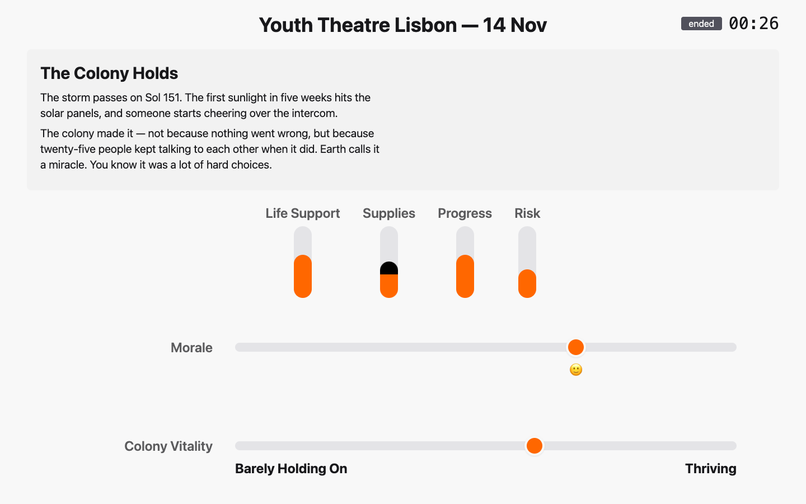

# The Scenex Tutorial

Scenex is a web platform for **writing and running megagames**: live,
facilitated performances in which a room full of people, split into groups,
make decisions under pressure while a game master tells the story and the
consequences show up on the wall.

This tutorial teaches the whole platform with one worked example, the
**Mars Colony** scenario. It is written for theatre makers and game
masters — no programming knowledge needed.

## Who this is for

- **Authors** who build or adapt a scenario (for example their own version of
  *Common Ground*). Read parts 1 and 2.
- **Game masters** who run a session in front of an audience. Read parts 1
  and 3 — and do one dry run from part 2 before the show.

## Contents

**Part 1 — The idea**

1. [How Scenex thinks](01-concepts.md) — scenarios and sessions, the three
   screens, and the vocabulary used everywhere else

**Part 2 — Writing a scenario (the editor)**

2. [Getting started](02-getting-started.md) — accounts, the scenario list, the editor
3. [Values and the Overall Index](03-values-and-index.md) — what the game measures
4. [Groups and starting values](04-groups.md) — who plays
5. [The timeline: Events, Wildcards and Votes](05-timeline.md) — what happens
6. [Labels, endings, pages, media and members](06-more-content.md)
7. [Translating a scenario](07-translation.md)
8. [The dry run](08-dry-run.md) — test your numbers before anyone plays

**Part 3 — Running a game (the GM console)**

9. [Creating a session](09-sessions.md) — one evening, one venue, QR codes
10. [Running the show from the GM console](10-gm-console.md)
11. [What the room sees](11-player-screens.md) — the group boards and the projected display
12. [Show-day checklist and troubleshooting](12-show-day.md)

**Appendix**

- [The Mars Colony scenario](mars-colony.md) — the example in full: story, numbers and balance
- [How this tutorial is made](regenerating.md) — regenerating screenshots and video

## The example: Mars Colony

Twenty-five people are the crew of humanity's first permanent colony on Mars,
organised in five teams. The story starts on Earth the night before launch,
follows the colony through touchdown and its first months, and then a dust
storm hits the power system the colony built. It runs 45–60 minutes.

Every screenshot in this tutorial shows Mars Colony. You can load the same
scenario into your own Scenex and click along — see [How this tutorial is
made](regenerating.md).

## Words used in this tutorial

The interface and this tutorial say **Vote** and **Wildcard**. If you ever
read the source code or older documents, the same things are called
*election* and *sidequest* there.
