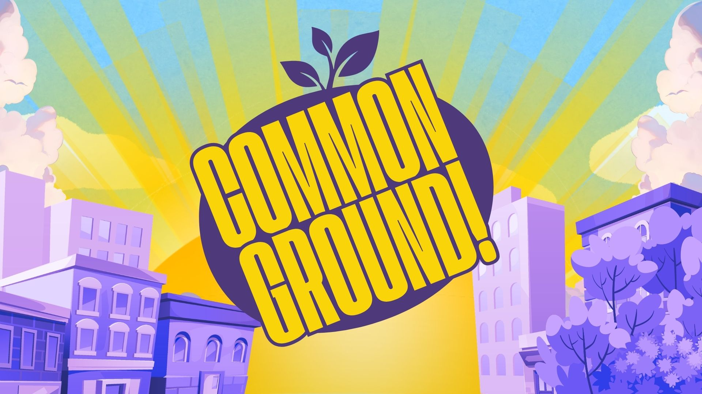

# Welcome to Scenex 🎭

**Scenex is a stage manager for megagames.** You write the play — the
groups, the dilemmas, the twists and the possible endings — and Scenex runs
it with you, live, in front of a room full of players: it hands every table
its choices, keeps score, and puts the state of the world on the big screen.

This tutorial is for **theatre makers and game masters**, not for
programmers. You'll find no code in here, and nothing you could break.

## One platform, any story

Scenex doesn't know what your game is about. A town council in crisis, the
crew of a spaceship, a village choosing its future — they are all just
*content* that you type into the same editor.

Throughout this tutorial we use **Common Ground** — a megagame about a town
in crisis and the art of compromise — as the running example. Now and then
we peek at a second, completely different example — **Mars Colony** — to
show that the very same building blocks tell a very different story.

> 💡 **Everything you see here works for any scenario.** Common Ground is
> just the example. When you read "Democracy Score" or "Chamber of
> Commerce", think: *that's what Common Ground calls it — mine might be
> different.*

## Where to start

- **"I want to understand the idea."** → Part 1. Twenty minutes, and you know
  every building block.
- **"I'm adapting Common Ground for my theatre."** → Part 1, then
  [Your Common Ground](08-your-common-ground.md), then the editor chapters as
  you need them.
- **"I'm running the show tonight."** → Part 1, then Part 3. Do one rehearsal
  session first.

## Contents

**Part 1 — The idea**

1. [What is Scenex?](01-what-is-scenex.md) — megagames, scripts and
   performances, the three screens
2. [The building blocks](02-building-blocks.md) — every concept, explained
   with Common Ground

**Part 2 — Writing a scenario**

3. [A tour of the editor](03-editor-tour.md)
4. [Values and the Democracy Score](04-values.md) — what the game measures
5. [Groups and starting values](05-groups.md) — who plays
6. [The timeline](06-timeline.md) — Events, Votes and Wildcards
7. [Pages, media, endings and more](07-pages-and-more.md)
8. [Your Common Ground](08-your-common-ground.md) — translating it and adding
   your own local touches
9. [The dry run](09-dry-run.md) — rehearse the numbers on your own

**Part 3 — Running a show**

10. [Creating a session](10-sessions.md) — one performance, one set of QR codes
11. [Running the show](11-running-the-show.md) — an evening of Common Ground,
    from the GM console
12. [What the room sees](12-what-the-room-sees.md) — group boards and the
    projected display
13. [Show-day checklist](13-show-day.md)

**Appendix**

- [Common Ground at a glance](common-ground.md) and its
  [complete content](common-ground-content.md)
- [Mars Colony](mars-colony.md) — the second example
- [How this tutorial is made](regenerating.md)

## Two words you'll meet

The screens say **Vote** and **Wildcard**. In older documents (and in the
source code) the same things are called *election* and *sidequest*.
